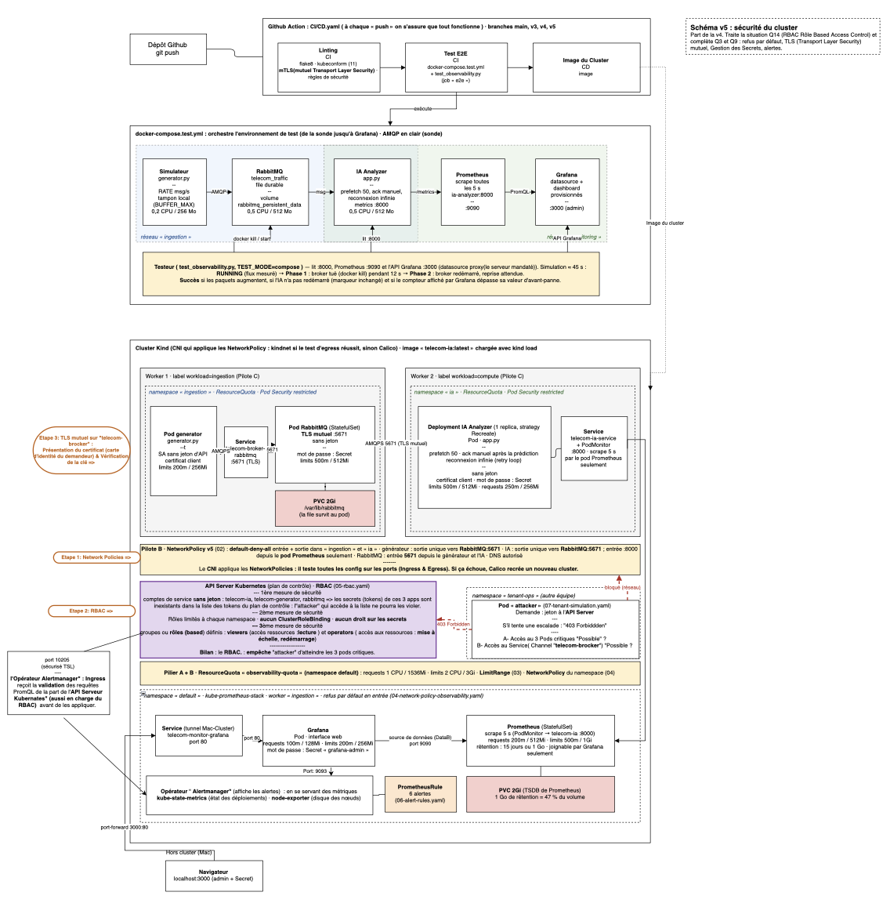

# 🔐 CloudIA v5 : sécurité du cluster (RBAC, isolation réseau, TLS, secrets)

[](https://github.com/CedricKoukoui/CloudIA/actions/workflows/ci-cd.yaml)

> 📊 **Schémas d'architecture** (à la racine du dépôt) : `schema-architecture-v4-limit.png` (ce que la v4 laisse ouvert) et `schema-architecture-v5.png` (la v5). Les sources modifiables sont `schema-architecture-v4-limit.drawio.html` et `schema-architecture-v5.drawio.html`.
>
> 

Ce document ne décrit que la **version v5**. Elle part de la v4 (rétention des métriques et ressources de l'observabilité), elle-même construite sur la v3 (isolation des ressources par cgroups, namespaces, quotas, `nodeSelector`). Pour les versions précédentes, voir les README des branches `v3` et `v4`.

---

## 1. En bref

*   **Situation traitée :** Q14 (RBAC dans un cluster mutualisé), avec les compléments de Q3 et Q9 (Zero Trust réseau).
*   **Ce que la v5 ajoute :** des droits Kubernetes limités à un namespace, des comptes de service sans jeton, des pods non-root, un refus par défaut du trafic entrant **et sortant**, un AMQP chiffré avec authentification mutuelle (TLS mutuel), des mots de passe dans des `Secret`, et des alertes qui rendent utiles Alertmanager, kube-state-metrics et node-exporter.
*   **Ce que la v5 vérifie :** un script de contrôle sur le cluster (`v5-checks.sh`), une simulation d'attaque d'un pod d'une autre équipe, et des contrôles automatiques en CI.
*   **Point de départ obligatoire :** un test qui prouve que le plugin réseau du cluster applique réellement le filtrage sortant (`v5-test-egress.sh`).

---

## 2. La situation

### 2.1 Q14 : le RBAC dans un cluster mutualisé

Le cluster Kubernetes souverain n'héberge pas seulement CloudIA : il est **mutualisé** (multi-tenant). À côté des pods de supervision télécom, une autre équipe a déployé un tableau de bord d'administration pour les opérateurs de terrain. Ce pod utilise un **compte par défaut** du cluster.

Suite à une attaque par hameçonnage, un conteneur de cette équipe est compromis. L'attaquant interroge directement l'**API Server** de Kubernetes. Comme le cluster est mal configuré, il réussit à :

1.  **lister tous les secrets** du cluster ;
2.  **modifier le nombre de répliques** du déploiement `ia-analyzer` pour le descendre à 0 (déni de service) ;
3.  **intercepter les jetons d'accès réseau** de RabbitMQ.

Le cloisonnement réseau (NetworkPolicy) ne suffit plus : l'attaquant ne passe pas par les pods, il parle au **plan de contrôle**. La question posée : comment configurer le **RBAC** (Role-Based Access Control) pour isoler l'application, restreindre les privilèges des pods et empêcher l'escalade de privilèges à l'échelle du cluster ?

### 2.2 Q3 : la sécurité des flux (Zero Trust)

Dans un cluster, les pods partagent le même réseau à plat par défaut. Si un attaquant prend le contrôle du pod `generator.py` (le simulateur d'antenne), comment l'empêcher :

*   de **scanner le cluster** ;
*   d'accéder au **port 8000 de l'IA** ;
*   de **falsifier les métriques Prometheus** ?

La réponse attendue : une politique réseau en **refus par défaut**, avec un générateur qui n'a le droit d'émettre (egress) que vers le port 5672 de RabbitMQ, un port 8000 de l'IA qui n'accepte que Prometheus, et une **authentification mutuelle (mTLS)** pour que le générateur s'authentifie cryptographiquement auprès de RabbitMQ.

### 2.3 Q9 : le cloisonnement des flux (Zero Trust et Network Policies)

Même scénario : le pod `generator.py` est compromis. Il ne doit pas accéder directement au port 8000 de l'IA ni **saturer Prometheus**. Le piège : croire que les conteneurs d'un cluster sont isolés par défaut, alors que tous les pods peuvent se parler. La réponse attendue : le principe Zero Trust au niveau du réseau, avec un générateur autorisé uniquement vers le port 5672 de RabbitMQ et un port 8000 de l'IA ouvert seulement au pod Prometheus.

---

## 3. Ce que la v4 couvre, et ce qui lui manque

**Déjà en place avant la v5**

*   `default-deny-ingress` dans les namespaces `ia` et `ingestion` (refus par défaut en entrée).
*   AMQP (5672) autorisé vers RabbitMQ depuis `ingestion` et `ia` ; métriques (8000) de l'IA autorisées depuis le namespace `default`.
*   Tests réseau A à D du README de la v3 : le générateur ne joint pas le port 8000 de l'IA, Prometheus le joint.
*   Quotas, `LimitRange` et `nodeSelector` : ils limitent les dégâts d'un pod qui s'emballe.

**Ce qui manque**

| # | Manque constaté en v4 | Situation | Traité en v5 par |
|---|---|---|---|
| 1 | Aucun filtrage du trafic sortant. | Q3, Q9 | `02-network-policy.yaml` (Egress) |
| 2 | Namespace `default` (Prometheus, Grafana, Alertmanager) sans aucune NetworkPolicy. | Q3, Q9 | `04-network-policy-observability.yaml` |
| 3 | Sources autorisées trop larges (un namespace entier, au lieu d'un pod). | Q9 | `02-network-policy.yaml` |
| 4 | Aucun `ServiceAccount` dédié ; jeton d'API monté dans tous les pods. | Q14 | `05-rbac.yaml`, manifestes des charges de travail |
| 5 | Aucun `Role` ni `RoleBinding`, aucun profil humain. | Q14 | `05-rbac.yaml` |
| 6 | Mots de passe en clair (3 manifestes, valeurs Helm de Grafana). | Q14 | `Secret` créés par `v5-secrets.sh` |
| 7 | Aucun `securityContext` ; aucun contrôle des privilèges des pods. | Q14 | manifestes + Pod Security `restricted` |
| 8 | AMQP en clair, sans authentification des clients. | Q3 | TLS mutuel (`amqp_tls.py`, `rabbitmq-v3-persistant.yaml`) |
| 9 | Isolation réseau testée à la main seulement. | Q3, Q9 | `v5-checks.sh`, `check_security.py` (CI) |
| 10 | Filtrage sortant jamais vérifié sur le CNI (`kindnet`). | Q3 | `v5-test-egress.sh`, puis Calico si besoin |
| 11 | Alertmanager, kube-state-metrics et node-exporter installés mais sans usage. | Q14, Q13 | `06-alert-rules.yaml` |

---

## 4. Comment on le résout : les étapes

**Principe général :** on ajoute les fichiers de la v5 sans toucher à la logique de la v4, avec un contrôle pour chaque protection.

| Étape | Action | Effet |
|---|---|---|
| **0. Le CNI** | Tester si le plugin réseau applique le filtrage **sortant** (`v5-test-egress.sh`). Sinon, recréer le cluster avec Calico (`v5-recreate-calico.sh`). | Les règles sortantes ne sont pas des déclarations sans effet. |
| **1. RBAC (Q14)** | `05-rbac.yaml` : un `ServiceAccount` par application avec `automountServiceAccountToken: false` ; des `Role` et `RoleBinding` minimaux par namespace ; deux profils humains, **lecteur** et **exploitant** (le seul à pouvoir changer `deployments/scale`). Simulation du scénario : un namespace `tenant-ops` avec un pod `attacker`. | Moindre privilège ; l'attaque de Q14 reçoit « Forbidden ». |
| **2. Secrets** | Les identifiants de RabbitMQ et de Grafana passent dans des `Secret` Kubernetes, référencés par `secretKeyRef`. Le script `v5-secrets.sh` les crée ; les manifestes ne contiennent plus de mot de passe. | Plus de mot de passe dans le dépôt. |
| **3. Durcissement des pods** | `securityContext` (`runAsNonRoot`, `allowPrivilegeEscalation: false`, capacités retirées, `seccomp`) et niveau **Pod Security `restricted`** sur `ia` et `ingestion`. | Un conteneur compromis garde peu de privilèges ; un pod privilégié est refusé. |
| **4. Réseau complet (Q3, Q9)** | Refus par défaut en entrée **et en sortie** dans `ia` et `ingestion`, flux sortants limités (générateur et IA vers RabbitMQ:5671 seulement), sources désignées par pod, refus par défaut en entrée dans `default`. | Un générateur compromis ne peut ni scanner, ni joindre l'IA, Prometheus ou l'API. |
| **5. Chiffrement (Q3)** | AMQP sur TLS avec un **certificat auto-signé** pour RabbitMQ, et authentification mutuelle : l'IA et le générateur présentent aussi un certificat. | Écoute et usurpation impossibles sur la connexion AMQP. |
| **6. Contrôle automatique** | `check_security.py` et `test_amqp_tls.py` en CI ; `v5-checks.sh` sur le cluster ; règle d'alerte `IaScaledToZero`. | Chaque protection est vérifiée, et la mise à 0 réplique est détectée. |

**Décisions prises avant de construire la v5**

| Sujet | Décision |
|---|---|
| Plugin réseau (CNI) | On reste sur `kindnet` si le test d'egress réussit ; **s'il échoue, on recrée le cluster avec Calico** (volumes et releases Helm perdus). |
| Alertmanager et node-exporter | **Déployés et utilisés** : six règles d'alerte (section 10). |
| Chiffrement | AMQP sur TLS avec certificat auto-signé, authentification **mutuelle**. |
| Mots de passe | **Conservés**, mais stockés dans des `Secret` générés par script, jamais dans les manifestes. |

---

## 5. Fichiers ajoutés ou modifiés

| Fichier | Statut | Rôle |
|---|---|---|
| `02-network-policy.yaml` | remplacé | Refus par défaut entrée + sortie dans `ia` et `ingestion` ; flux limités à des pods précis ; AMQP chiffré seulement. |
| `04-network-policy-observability.yaml` | nouveau | Refus par défaut en entrée dans `default`, puis ouvertures ciblées (Prometheus, Grafana, webhook). |
| `05-rbac.yaml` | nouveau | Comptes de service sans jeton ; rôles « lecteur » et « exploitant » limités aux namespaces ; aucun droit sur les secrets. |
| `06-alert-rules.yaml` | nouveau | Règles `PrometheusRule` : IA mise à 0 réplique, IA ou broker indisponible, rétention proche de sa limite, disque d'un nœud. |
| `07-tenant-simulation.yaml` | nouveau | Pod « attaquant » d'une autre équipe, pour la démonstration de Q14. |
| `rabbitmq-v3-persistant.yaml`, `deployment.yaml`, `generator-deployment.yaml` | modifiés | Compte de service dédié, `securityContext`, identifiants lus dans un Secret, AMQP sur le port 5671 avec certificats. |
| `observability-values.yaml` | modifié | Mot de passe de Grafana lu dans le Secret `grafana-admin`. |
| `amqp_tls.py` | nouveau | Paramètres de connexion RabbitMQ : `amqps://`, vérification du broker, certificat client. |
| `app.py`, `generator.py` | modifiés | Utilisent `amqp_tls.build_params` (la connexion en clair `amqp://` reste possible pour la sonde Compose). |
| `v5-test-egress.sh` | nouveau | Étape 0 : le CNI applique-t-il le filtrage sortant ? |
| `v5-recreate-calico.sh`, `kind-config-calico.yaml` | nouveaux | Recréent le cluster avec Calico si le test précédent échoue. |
| `v5-secrets.sh` | nouveau | Crée l'autorité de certification, les certificats et tous les Secrets ; change le mot de passe du compte RabbitMQ existant. |
| `v5-checks.sh` | nouveau | Contrôles sur le cluster : secrets, TLS, réseau, RBAC, attaque simulée, alertes. |
| `test_amqp_tls.py`, `check_security.py` | nouveaux | Contrôles de la CI, sans cluster. |
| `.github/workflows/ci-cd.yaml`, `kind-e2e.yaml` | modifiés | Branche `v5`, nouveaux contrôles ; le workflow Kind déploie la v5 (choix du CNI). |
| `03-observability-quota.yaml` | commentaire corrigé | Marges réelles du quota (74 %, 37 %, 54 %, 37 %). |
| `.gitignore` | nouveau (à fusionner) | Exclut `.venv`, les clés privées et les certificats. |

---

## 6. Q14 : le RBAC, étape par étape

Le scénario, et ce qui l'arrête :

| Étape de l'attaque | Défense | Où |
|---|---|---|
| Le pod compromis utilise le jeton de son compte par défaut. | Ce compte n'a **aucun droit** hors de son namespace : aucun `ClusterRoleBinding` n'est créé par le projet. | `05-rbac.yaml` |
| Il liste les secrets du cluster. | Aucun rôle du projet ne contient la ressource `secrets`, même pour l'exploitant. Réponse de l'API : `403 Forbidden`. | `05-rbac.yaml` |
| Il met `ia-analyzer` à 0 réplique. | Seul le groupe `cloudia:operators` peut modifier `deployments/scale`, et seulement dans `ia` et `ingestion`. Réponse : `403`. | `05-rbac.yaml` |
| Il lit les identifiants RabbitMQ. | Ils sont dans des Secrets inaccessibles ; ils n'apparaissent plus dans les manifestes. | `v5-secrets.sh` |
| Il vole le jeton d'un pod du projet. | Les pods du projet n'ont **pas de jeton** monté (`automountServiceAccountToken: false`) : rien à voler. | manifestes |
| Il se connecte au broker. | Le réseau refuse la connexion (autre namespace) et le TLS mutuel exigerait un certificat. | sections 7 et 8 |
| Un acteur autorisé met quand même l'IA à 0. | L'alerte `IaScaledToZero` se lève en 30 s. Le RBAC limite *qui*, l'alerte détecte *quand même*. | `06-alert-rules.yaml` |

**Profils humains (groupes) :**

| Groupe | Droits dans `ia` et `ingestion` | Dans `default` |
|---|---|---|
| `cloudia:viewers` | Lecture des pods, journaux, services, événements, déploiements. | Lecture seule. |
| `cloudia:operators` | Idem + modifier l'échelle, supprimer un pod, `port-forward`. | Lecture seule. |
| aucun des deux | Aucun droit. | Aucun droit. |

**Durcissement des pods (pour « restreindre les privilèges ») :** `runAsNonRoot` (uid 10001 pour l'IA et le générateur, 999 pour RabbitMQ), `allowPrivilegeEscalation: false`, toutes les capacités Linux retirées, profil `seccomp` `RuntimeDefault`. Les namespaces `ia` et `ingestion` appliquent le niveau **Pod Security `restricted`** : un pod privilégié y est refusé à la création.

**Simulation :** `07-tenant-simulation.yaml` crée un namespace `tenant-ops` et un pod `attacker` qui **conserve son jeton** (comportement par défaut de Kubernetes). `v5-checks.sh` y rejoue l'attaque : témoin HTTP 200 (le jeton fonctionne), puis HTTP 403 sur la lecture des secrets et sur la mise à 0 réplique, et la connexion au broker bloquée par le réseau.

---

## 7. Q3 et Q9 : isolation réseau

Flux autorisés (tout le reste est refusé) :

| Source → destination | Port | Autorisé |
|---|---|---|
| Générateur → RabbitMQ | 5671 (AMQP chiffré) | oui |
| IA → RabbitMQ | 5671 | oui |
| Pod Prometheus → IA | 8000 (métriques) | oui |
| Grafana → Prometheus, Alertmanager | 9090, 9093 | oui |
| Prometheus → cibles du namespace `default` | tous | oui |
| Tous les pods → DNS (`kube-dns`) | 53 | oui |
| Générateur → IA | 8000 | **non** (Q9) |
| Générateur → Prometheus, Grafana | tous | **non** (Q9 : saturer Prometheus) |
| Générateur, IA → API Kubernetes | 443 | **non** (Q3 : scanner le cluster) |
| N'importe quel pod → RabbitMQ en clair | 5672 | **non** |
| Pod d'un autre namespace → RabbitMQ | 5671 | **non** |

**Le CNI doit appliquer ces règles.** Une NetworkPolicy n'est qu'une déclaration : c'est le plugin réseau (CNI) qui bloque les paquets. Le README de la v3 (section 9) prouvait le filtrage entrant avec `kindnet`. Le filtrage sortant n'était pas prouvé. `v5-test-egress.sh` le vérifie avec deux pods jetables.

*   **Réussite** : on continue sur le cluster actuel.
*   **Échec** : `v5-recreate-calico.sh` supprime le cluster et le recrée avec **Calico** (`kind-config-calico.yaml`, cluster `cloudia-v5`). Sont perdus : le volume de RabbitMQ, l'historique de Prometheus, les releases Helm. Le script demande confirmation.

---

## 8. Q3 : chiffrement et authentification mutuelle (TLS)

*   **Autorité de certification auto-signée** créée par `v5-secrets.sh`, avec trois certificats : un pour RabbitMQ (serveur), un pour l'IA et un pour le générateur (clients). Validité des certificats : 825 jours ; de l'autorité : 10 ans.
*   **RabbitMQ** écoute en TLS sur le port 5671 avec `verify_peer` et `fail_if_no_peer_cert = true` : un client sans certificat valide est refusé, même avec le bon mot de passe. Le port 5671 est le seul exposé par le Service et le seul autorisé par la NetworkPolicy.
*   **Côté applications**, `amqp_tls.py` vérifie le certificat du broker (nom DNS complet du service) et présente le certificat client. L'URL en `amqp://` reste utilisée par la sonde Docker Compose de la CI, sans TLS.
*   **Les clés privées** sont créées dans `~/.cloudia-v5-tls`, **hors du dépôt**, et ne doivent jamais être commitées (`.gitignore` exclut `*.key` et `*.pem`).
*   **Pas de maillage de services** (Istio, Linkerd) : trop lourd pour la machine de test. Le TLS mutuel est limité à la connexion AMQP ; les métriques (port 8000) circulent en clair, mais seul le pod Prometheus y a accès.

---

## 9. Mots de passe et Secrets

*   **Où sont les mots de passe :** dans des `Secret` Kubernetes (`rabbitmq-credentials` dans `ia` et `ingestion`, `grafana-admin` dans `default`), générés au hasard par `v5-secrets.sh`, ou fournis (`RABBITMQ_PASSWORD=... GRAFANA_PASSWORD=... ./v5-secrets.sh`).
*   **Comment les pods les lisent :** `secretKeyRef` dans les manifestes ; l'URL est composée par Kubernetes avec `$(RABBITMQ_USER)` et `$(RABBITMQ_PASSWORD)`.
*   **Compte RabbitMQ existant :** RabbitMQ ne lit `RABBITMQ_DEFAULT_PASS` qu'à la création du compte. Sur le volume de la v3, le compte `user` garde l'ancien mot de passe ; `v5-secrets.sh` le change avec `rabbitmqctl change_password` si le broker tourne.
*   **Relancer le script** réutilise les certificats et les mots de passe déjà créés.
*   **Contrôle en CI :** `check_security.py` refuse tout `utilisateur:motdepasse@` en clair et toute variable de mot de passe qui ne vient pas d'un Secret.
*   **Le compose de test** (`docker-compose.test.yml`) garde `user` / `password` : c'est une sonde jetable, sans cluster.

---

## 10. Alertes : rôle d'Alertmanager, kube-state-metrics et node-exporter

| Alerte | Condition | Composant exploité | Situation |
|---|---|---|---|
| `IaScaledToZero` | réplicas demandées de l'IA = 0 pendant 30 s | kube-state-metrics | Q14 |
| `IaUnavailable` | aucun pod d'IA disponible pendant 1 min | kube-state-metrics | Q14 |
| `BrokerUnavailable` | aucun pod RabbitMQ prêt pendant 1 min | kube-state-metrics | Q11 |
| `IaMetricsMissing` | cible de l'IA absente de Prometheus pendant 2 min | Prometheus | Q9 |
| `PrometheusStorageNearRetentionLimit` | base > 90 % de la limite de rétention pendant 10 min | Prometheus | Q13 |
| `NodeDiskAlmostFull` | moins de 10 % d'espace libre sur un nœud | node-exporter | capacité |

Les alertes s'affichent dans Prometheus (`/alerts`) et dans l'interface d'Alertmanager. **Aucun destinataire n'est configuré** (e-mail, Slack) : Alertmanager les montre sans les envoyer.

---

## 11. Mise en œuvre

**Prérequis hérités de la v3 et de la v4** (fichiers inchangés, non décrits ici) : Docker, `kind`, `kubectl`, `helm` et `openssl` installés ; `Dockerfile`, `requirements.txt`, `01-namespaces-quotas.yaml`, `prometheus-link.yaml`, `kind-config.yaml`, `docker-compose.test.yml`, `test_observability.py` et le dossier `observability/` ; une release Helm `telecom-monitor` si le cluster de la v4 existe déjà.

Cette procédure remplace l'étape de déploiement du guide d'exploitation de la v3 (README de la v3, section 11). Le nom du cluster est `cloudia-v3` (CNI `kindnet`) ou `cloudia-v5` (Calico).

```bash
git checkout v4 && git pull origin v4 && git checkout -b v5   # puis copier les fichiers de la v5

# 0. Le CNI applique-t-il le filtrage sortant ?
./v5-test-egress.sh
#    Échec -> ./v5-recreate-calico.sh (recrée le cluster avec Calico), puis relancer ./v5-test-egress.sh

# 1. Image (elle contient le code TLS) et namespaces
docker build -t telecom-ia:latest .
kind load docker-image telecom-ia:latest --name cloudia-v3        # ou cloudia-v5
kubectl apply -f 01-namespaces-quotas.yaml
kubectl label namespace ia ingestion pod-security.kubernetes.io/enforce=restricted --overwrite

# 2. Certificats et Secrets (affiche le mot de passe de Grafana)
./v5-secrets.sh

# 3. Pile d'observabilité (version du chart : colonne CHART de « helm list », par exemple 92.3.0)
helm repo update
helm upgrade --install telecom-monitor prometheus-community/kube-prometheus-stack \
  --version 92.3.0 -f observability-values.yaml
kubectl get pods -n default -w               # attendre que tout soit Running (Ctrl+C ensuite)
kubectl apply -f 03-observability-quota.yaml -f 05-rbac.yaml -f 06-alert-rules.yaml

# 4. Broker (nouvelle configuration TLS, non-root), puis relancer le script si le volume existait déjà
kubectl apply -f rabbitmq-v3-persistant.yaml
kubectl rollout status statefulset/telecom-broker-rabbitmq -n ingestion --timeout=240s
./v5-secrets.sh

# 5. Réseau : vérifier les labels, retirer les anciennes règles de la v3, appliquer la v5
./v5-checks.sh preflight
kubectl delete networkpolicy default-deny-ingress -n ia --ignore-not-found
kubectl delete networkpolicy default-deny-ingress allow-amqp-to-rabbitmq -n ingestion --ignore-not-found
kubectl apply -f 04-network-policy-observability.yaml
kubectl apply -f deployment.yaml -f generator-deployment.yaml -f prometheus-link.yaml
kubectl apply -f 02-network-policy.yaml
kubectl rollout status deploy/telecom-ia-deployment -n ia --timeout=240s
kubectl rollout status deploy/telecom-generator-deployment -n ingestion --timeout=240s

# 6. Contrôles (avec la simulation d'attaque), puis nettoyage
kubectl apply -f 07-tenant-simulation.yaml
./v5-checks.sh
SCALE_TEST=1 ./v5-checks.sh      # facultatif : met l'IA à 0 réplique et attend l'alerte (≈ 2 min)
kubectl delete -f 07-tenant-simulation.yaml
```

*   **Mot de passe de RabbitMQ (console 15672, via `port-forward`) :** `kubectl get secret -n ingestion rabbitmq-credentials -o jsonpath='{.data.password}' | base64 --decode; echo`
*   **Si un pod de la pile ne devient plus prêt après l'étape 5** : `kubectl delete -f 04-network-policy-observability.yaml`, puis lire `kubectl describe pod` (un label attendu peut différer sur ta version du chart).
*   **Si le pod RabbitMQ ne démarre pas en non-root** : lire `kubectl logs -n ingestion telecom-broker-rabbitmq-0`. Retirer alors le bloc `securityContext` de ce StatefulSet (le reste de la v5 fonctionne sans) et le noter dans les limites.

---

## 12. CI/CD (`.github/workflows/`)

**`ci-cd.yaml`** : déclenché à chaque push et pull request sur `main`, `v3`, `v4` et `v5`.

| Étape du job « Linting » | Ce qu'elle contrôle |
|---|---|
| flake8 | Erreurs de syntaxe et noms indéfinis dans le code Python. |
| Configuration d'observabilité | YAML et JSON valides ; ressources, rétention, `nodeSelector` des valeurs Helm (v4). |
| **Test du client TLS** (`test_amqp_tls.py`) | Poignée de main TLS mutuelle avec de vrais certificats : acceptée, refusée sans certificat client, refusée avec une autre autorité. |
| **Règles de sécurité** (`check_security.py`) | Comptes de service dédiés et sans jeton, pods non-root, aucun mot de passe en clair, refus par défaut en entrée et sortie, aucun `ClusterRoleBinding`, aucun droit sur les secrets, mot de passe Grafana en Secret, règle `IaScaledToZero`. |
| shellcheck | Les scripts `v5-*.sh`. |
| `docker compose config` | Le fichier de la sonde Compose. |
| kubeconform (mode strict) | 11 manifestes, schémas des CRD inclus (PodMonitor, PrometheusRule). |

Puis le job « e2e » (sonde Compose jusqu'à Grafana, crash-test du broker) et le job d'image (push uniquement). La sonde Compose reste en AMQP **sans TLS** : elle ne remplace pas le test sur Kind.

**`kind-e2e.yaml`** : déclenché **à la demande** (Actions > « Kind E2E (manuel) » > Run workflow). Il crée un cluster Kind avec le CNI choisi (`calico` par défaut, ou `kindnet`), vérifie que l'egress est appliqué, déploie la v5 (Secrets, RBAC, TLS, politiques réseau), lance `v5-checks.sh` en `CI_MODE` (sans la pile d'observabilité) puis le crash-test du broker.

---

## 13. Contrôles et statut de vérification

### 13.1 Ce que fait `v5-checks.sh`

| Bloc | Contrôles |
|---|---|
| Secrets | Les 6 Secrets existent ; aucun mot de passe en clair dans les déploiements. |
| Pods | Aucun jeton de compte de service monté ; processus non-root. |
| Pod Security | Niveau `restricted` sur `ia` et `ingestion` ; un pod privilégié est refusé (essai à blanc côté serveur). |
| TLS (Q3) | Avec certificat client : le broker répond ; sans : il refuse ; l'IA traite des messages. |
| Réseau (Q3, Q9) | Autorisés : générateur → RabbitMQ:5671, IA → RabbitMQ:5671, Prometheus → IA. Bloqués : générateur → RabbitMQ:5672, IA:8000, Prometheus:9090, Grafana:3000, API Kubernetes ; IA → API et Prometheus. |
| RBAC (Q14) | 12 contrôles : 11 cas avec `kubectl auth can-i` (lecteur, exploitant, comptes de service) et aucun `ClusterRoleBinding` visant un sujet du projet. |
| Attaque simulée (Q14) | Depuis le pod `attacker` : témoin HTTP 200, puis HTTP 403 sur les secrets (`ia`, `ingestion`, cluster entier) et sur la mise à 0 réplique ; l'IA garde 1 réplique ; connexion au broker bloquée. |
| Alertes | Les 6 règles sont chargées (Prometheus est interrogé par `kubectl port-forward` depuis le poste, car son image n'a pas `wget`) ; avec `SCALE_TEST=1`, l'IA est mise à 0 réplique et l'alerte `IaScaledToZero` doit se lever (environ 2 minutes). |

### 13.2 Ce qui a été vérifié, et ce qui ne l'est pas

**Vérifié hors cluster :**

*   les 36 ressources des manifestes passent `kubeconform` en mode strict, schémas des CRD inclus ;
*   la logique TLS mutuelle du client est testée avec de vrais certificats (`test_amqp_tls.py`) ;
*   `check_security.py` détecte un mot de passe réintroduit ou un droit sur les secrets ;
*   les scripts passent `bash -n`, les workflows passent `actionlint`.

**Vérifié sur le cluster Kind (CNI `kindnet`, cluster `cloudia-v3`) :**

*   `v5-test-egress.sh` : `kindnet` applique le filtrage **sortant** ; Calico n'est pas nécessaire ;
*   RabbitMQ démarre avec la configuration TLS, en non-root, et écoute en TLS sur le port 5671 ;
*   `v5-checks.sh preflight` : les labels des pods de `kube-prometheus-stack`, les pods DNS et le label `workload` des nœuds sont conformes ;
*   les politiques réseau de la v5 sont appliquées sans bloquer Prometheus, Grafana ni le webhook d'admission ;
*   `v5-checks.sh` : tous les contrôles passent (Secrets, pods non-root sans jeton, Pod Security, TLS mutuel, isolation réseau, RBAC, attaque simulée, règles d'alerte chargées).

**Non vérifié :**

*   le test `SCALE_TEST=1` (mise de l'IA à 0 réplique, alerte `IaScaledToZero`), à lancer une fois ;
*   l'exécution des workflows GitHub Actions `ci-cd.yaml` et `kind-e2e.yaml` sur le dépôt (à lancer après le push de la branche `v5`) ;
*   le chemin Calico (`v5-recreate-calico.sh`, `kind-config-calico.yaml`), non utilisé puisque `kindnet` a réussi le test d'egress ;
*   le comportement avec un volume RabbitMQ créé à partir de zéro (le test a été fait sur un volume existant de la v4).

## 14. Limites de la v5

*   **Dépend du CNI.** Sans filtrage sortant appliqué par le plugin réseau, les règles `Egress` sont inopérantes (d'où le test et le recours à Calico).
*   **Certificats auto-signés, rotation manuelle.** Pas de `cert-manager`, pas de révocation. Les clés restent sur le poste de travail.
*   **TLS limité à AMQP.** Les métriques (8000), Grafana et Prometheus restent en HTTP dans le cluster, protégés par le réseau.
*   **Écouteur AMQP en clair.** Il existe toujours à l'intérieur du pod RabbitMQ, mais ni le Service ni la NetworkPolicy ne l'exposent. Le supprimer côté broker (`listeners.tcp = none`) n'a pas été testé ici.
*   **Interface de gestion RabbitMQ** (15672) en HTTP : accessible seulement par `port-forward`.
*   **Secrets Kubernetes non chiffrés dans `etcd`** (valeur par défaut de Kind). Toute personne ayant les droits d'administrateur ou l'accès au nœud peut les lire. En production : chiffrement au repos et gestionnaire de secrets externe.
*   **Le RBAC ne protège pas contre un administrateur du cluster.** Si un `ClusterRoleBinding` donne `cluster-admin` à un pod, rien n'empêche l'attaque : le RBAC du projet n'agit que sur les droits qu'il octroie. La mise à 0 réplique par un exploitant légitime est seulement détectée (alerte), pas empêchée.
*   **Identités humaines simulées.** Les groupes `cloudia:viewers` et `cloudia:operators` sont testés par usurpation (`--as`). Il n'y a pas de fournisseur d'identité (OIDC).
*   **Alertes sans destinataire.** Visibles dans les interfaces, jamais envoyées.
*   **Système de fichiers des conteneurs non verrouillé en lecture seule** (`readOnlyRootFilesystem` non appliqué).
*   **Pas de maillage de services.** Pas de chiffrement automatique entre tous les pods ni de politique d'autorisation par identité.

---

## 15. Registre des paramètres de la v5

| Paramètre | Valeur | Défini dans | Justification |
|---|---|---|---|
| Refus par défaut du réseau | entrée + sortie dans `ia` et `ingestion` ; entrée dans `default` | `02-network-policy.yaml`, `04-network-policy-observability.yaml` | Q3, Q9 : un pod compromis ne peut rien joindre qui n'ait été autorisé. |
| Flux autorisés | générateur et IA vers RabbitMQ:5671 ; pod Prometheus vers IA:8000 | `02-network-policy.yaml` | Moindre privilège, sources désignées par pod. |
| Port AMQP | 5671 (TLS mutuel) | `rabbitmq-v3-persistant.yaml`, `deployment.yaml`, `generator-deployment.yaml` | Q3 : chiffrement et authentification des clients. |
| Certificats | autorité 10 ans, certificats 825 jours, dans `~/.cloudia-v5-tls` | `v5-secrets.sh` | Auto-signés, hors du dépôt. |
| Identifiants RabbitMQ et Grafana | Secrets `rabbitmq-credentials`, `grafana-admin` | `v5-secrets.sh` | Q14 : plus de mot de passe dans les manifestes. |
| Comptes de service | `telecom-ia`, `telecom-generator`, `rabbitmq` ; jeton non monté | `05-rbac.yaml` | Q14 : aucun jeton d'API à voler dans un pod. |
| Rôles humains | groupes `cloudia:viewers`, `cloudia:operators` | `05-rbac.yaml` | Q14 : lecture seule ou exploitation, jamais les secrets. |
| Utilisateur des conteneurs | uid 10001 (IA, générateur), 999 (RabbitMQ) | manifestes | Q14 : plus de root. |
| Pod Security | niveau `restricted` sur `ia` et `ingestion` | `kubectl label namespace` (section 11) | Q14 : un pod privilégié est refusé. |
| Alertes | 6 règles `PrometheusRule` | `06-alert-rules.yaml` | Détection : IA à 0 réplique, broker indisponible, rétention, disque. |
