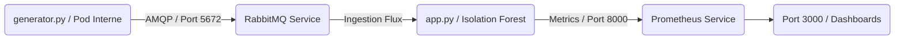

# 📡 CloudIA : Architecture Souveraine & IA pour la Supervision Télécom (Version v2bis)

> 📊 **Note d'architecture :** Le schéma détaillé de cette infrastructure Cloud-Native est disponible au format vectoriel dans le fichier `schema-architecture.pdf` et au format image dans `schema-architecture-v2.png` à la racine de ce dépôt.

Ce projet implémente un prototype d'architecture Cloud-Native, asynchrone (Event-Driven) et monitorée, dédiée à la détection d'anomalies quasi temps réel sur des flux de télécommunications.

---

## 🏗️ Cartographie de l'Architecture & Rôle des Fichiers

L'architecture est découpée en microservices découplés au sein du cluster :



*   `app.py` : Cœur analytique avec un modèle Isolation Forest, consommation passive des messages (anti-erreur 406) et exposition des métriques Prometheus.
*   `generator.py` : Simulateur réseau injectant des métriques de trafic, enrichi d'un nettoyage automatique des files corrompues.
*   `test_observability.py` : Sonde de test automatique pour la CI.
*   `Dockerfile`, `deployment.yaml`, `generator-deployment.yaml`, `prometheus-link.yaml` : Configuration conteneurisée et orchestration Kubernetes.

---

## 🚀 Guide d'Exploitation : Récupération & Lancement Local

### 1. Clonage et environnement

```bash
git clone https://github.com/CedricKoukoui/CloudIA.git
cd CloudIA && git checkout v2bis
python3 -m venv .venv && source .venv/bin/activate
pip install -r requirements.txt
```

### 2. Déploiement Kubernetes (Kind)

Compilation sans cache, chargement de l'image locale, déploiement du broker, configuration de l'administrateur, puis application des manifestes applicatifs :

```bash
# A. Compilation de l'image d'infrastructure globale
docker build --no-cache -t telecom-ia:latest .
kind load docker-image telecom-ia:latest --name telecom-cluster

# B. Déploiement et configuration des accès de RabbitMQ
kubectl create deployment telecom-broker-rabbitmq --image=rabbitmq:3-management --port=5672
kubectl expose deployment telecom-broker-rabbitmq --port=5672 --target-port=5672 --name=telecom-broker-rabbitmq

kubectl exec deployment/telecom-broker-rabbitmq -- rabbitmqctl add_user user password
kubectl exec deployment/telecom-broker-rabbitmq -- rabbitmqctl set_user_tags user administrator
kubectl exec deployment/telecom-broker-rabbitmq -- rabbitmqctl set_permissions -p / user ".*" ".*" ".*"

# C. Déploiement de l'IA, du Générateur Interne et du lien Prometheus
kubectl apply -f deployment.yaml
kubectl apply -f generator-deployment.yaml
kubectl apply -f prometheus-link.yaml
kubectl rollout restart deployment telecom-monitor-kube-prome-operator
```

### 3. Orchestration des Tunnels Locaux (2 fenêtres requises)

*   **Terminal 1 (Supervision) :** Ouvrir l'accès permanent à l'interface de Grafana :
    ```bash
    kubectl port-forward svc/telecom-monitor-grafana 3000:80 --address 127.0.0.1
    ```
*   **Terminal 2 (Contrôle / Exploitation) :** Laissez cet onglet libre pour piloter votre cluster Kind et simuler les pannes à l'aide de `kubectl`.

### 4. Visualisation de la Supervision (Grafana)

Rendez-vous sur votre navigateur à l'adresse `http://127.0.0.1:3000` (Identifiants : `admin` / `prom-operator`).

Ajoutez une visualisation Prometheus et utilisez la requête **PromQL** globale suivante pour afficher la courbe d'activité en temps réel :
```promql
sum(telecom_processed_packets_total)
```
*Ajustez la plage de temps en haut à droite sur **Last 5 minutes** et le rafraîchissement automatique sur **5s**.*

---

## 🔍 Point de Situation Technique & Nouvelle Limite

### Bilan de fonctionnement (Le Rebond v2bis)
Le déploiement du simulateur directement dans le cluster via `generator-deployment.yaml` a éliminé la dépendance vis-à-vis des tunnels réseau externes du Mac. Lors de la suppression forcée du pod RabbitMQ (`kubectl delete pod -l app=telecom-broker-rabbitmq`), le flux de production continue de saturer le réseau interne. Au redémarrage du broker, l'IA se reconnecte seule de manière passive et absorbe instantanément l'historique : **le trafic continue d'évoluer sur Grafana et le rebond de reprise après sinistre est validé.**

### La nouvelle limite détectée
La reconnexion et le traitement immédiat des messages accumulés provoquent un pic brutal de charge matérielle. Sans mécanisme de régulation, les pods d'IA entrent temporairement en statut **`CrashLoopBackOff`** sous la pression de l'orchestrateur.

---

## 🚀 Prochaine Étape : Version v3
La version **v3** sera entièrement consacrée à parfaire la v2bis en configurant des quotas stricts de ressources matérielles (`requests` et `limits` CPU/RAM) dans Kubernetes pour lisser ces pics de charge.

