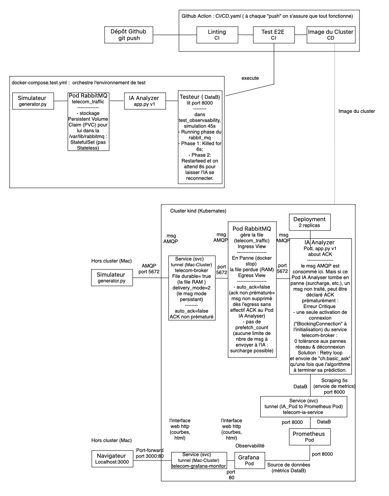
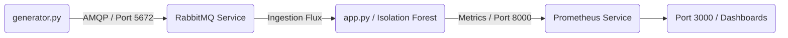
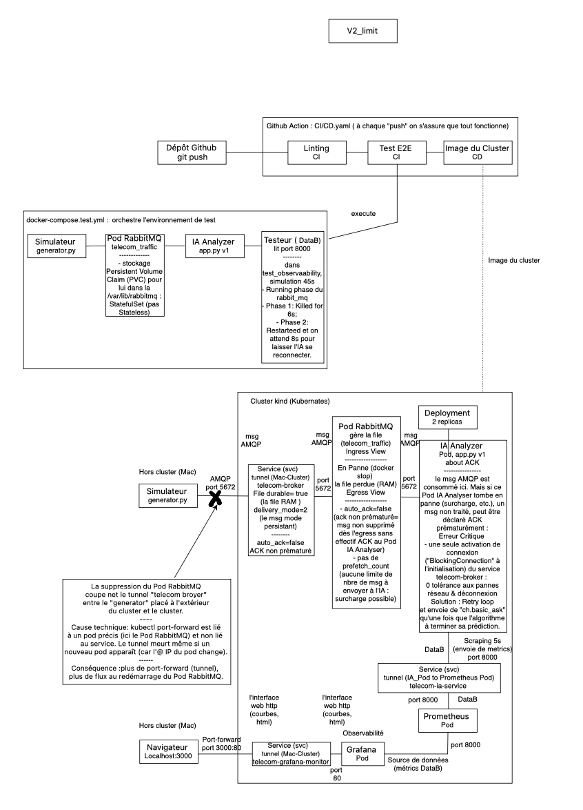

# 📡 CloudIA : Architecture Souveraine & IA pour la Supervision Télécom (Version v2)

> 📊 **Note d'architecture :** Le schéma détaillé de cette infrastructure Cloud-Native est disponible au format vectoriel dans le fichier `schema-architecture.pdf` et au format image dans `schema-architecture-v2.png` à la racine de ce dépôt.

Ce projet implémente un prototype d'architecture Cloud-Native, asynchrone (Event-Driven) et monitorée, dédiée à la détection d'anomalies quasi temps réel sur des flux de télécommunications.




## 🏗️ Cartographie de l'Architecture & Rôle des Fichiers

L'architecture est découpée en microservices découplés :



*   `app.py` : Cœur analytique avec un modèle Isolation Forest et exposition des métriques Prometheus.
*   `generator.py` : Simulateur réseau injectant des métriques de trafic.
*   `test_observability.py` : Sonde de test automatique pour la CI.
*   `Dockerfile`, `deployment.yaml`, `prometheus-link.yaml` : Configuration conteneurisée et Kubernetes.

## 🚀 Guide d'Exploitation : Récupération & Lancement Local

### 1. Clonage et environnement

```bash
git clone https://github.com/CedricKoukoui/CloudIA.git
cd CloudIA && git checkout v2
python3 -m venv .venv && source .venv/bin/activate
pip install -r requirements.txt
```

### 2. Déploiement Kubernetes (Kind)

Compilation, chargement de l'image locale, déploiement de RabbitMQ, configuration administrateur, puis application de `deployment.yaml` et `prometheus-link.yaml` :

```bash
docker build -t telecom-ia:v1 .
kind load docker-image telecom-ia:v1 --name telecom-cluster

helm repo add bitnami https://charts.bitnami.com/bitnami
helm repo update
helm install telecom-broker bitnami/rabbitmq \
  --set auth.username=user \
  --set auth.password=password \
  --set replicaCount=1

kubectl apply -f deployment.yaml
kubectl apply -f prometheus-link.yaml
```

### 3. Orchestration (3 terminaux requis)

*   **Terminal 1 :** tunnel réseau RabbitMQ
```bash
    kubectl port-forward svc/telecom-broker-rabbitmq 5672:5672
```

### 4. Schéma d'architecture de V2-limit



  --set auth.username=user \
  --set auth.password=password \
  --set replicaCount=1

kubectl apply -f deployment.yaml
kubectl apply -f prometheus-link.yaml
```

### 3. Orchestration (3 terminaux requis)

*   **Terminal 1 :** tunnel réseau RabbitMQ
```bash
    kubectl port-forward svc/telecom-broker-rabbitmq 5672:5672

