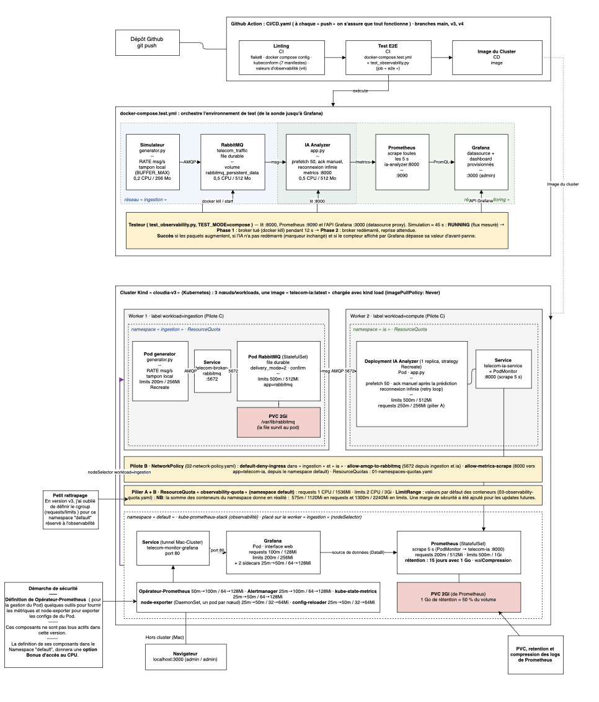

# 📦 CloudIA v4 : rétention des métriques et ressources de l'observabilité

> 📊 **Schéma d'architecture** : `schema-architecture-v4.png` (source modifiable : `schema-architecture-v4.drawio.html`).
>
> 

Ce document ne décrit que la **version v4**. Elle part de la v3 (isolation des ressources par cgroups, namespaces, quotas, `nodeSelector`, NetworkPolicy), décrite dans le README de la branche `v3`. La suite, la v5 (sécurité : RBAC, isolation réseau complète, TLS, Secrets), est décrite dans le README de la branche `v5`.

---

## 1. En bref

*   **Situation traitée :** Q13 (le stockage de Prometheus) et le rattrapage de la question de la v3 sur les ressources, qui ne couvrait pas la pile d'observabilité.
*   **Ce que la v4 ajoute :** une stratégie de rétention (durée et taille) sur un volume dédié pour Prometheus, des `requests/limits` pour chaque conteneur de la pile d'observabilité, un quota et un `LimitRange` pour le namespace `default`, et le placement de la pile sur le worker `ingestion`.
*   **Comment c'est déployé :** une mise à jour Helm de `kube-prometheus-stack` avec un fichier de valeurs (`observability-values.yaml`), puis un manifeste pour le quota. Aucune modification du code de l'IA ni du générateur.

---

## 2. La situation

### 2.1 Q13 : Prometheus va saturer le disque

Prometheus stocke toutes les métriques dans une base locale (TSDB). Sans limite, cette base grossit tant que l'application tourne, jusqu'à remplir le disque du nœud. Un disque plein ne fait pas tomber que Prometheus : kubelet, les autres pods du nœud et le système lui-même peuvent être affectés. La question posée : **quelle stratégie évite la panne de stockage ?**

La réponse retenue est une **stratégie de rétention** : limiter la durée de conservation, limiter la taille de la base, et isoler le stockage sur un volume dédié et borné.

### 2.2 Rattrapage de la v3 : l'observabilité n'était pas protégée

La question de la v3 était : « si l'IA sature le CPU, comment garantir que RabbitMQ ou Prometheus ne crashent pas ? » La v3 n'avait traité que RabbitMQ. Prometheus et Grafana tournent dans le namespace `default` avec les valeurs par défaut du chart Helm : ni `requests/limits`, ni `nodeSelector`, ni `ResourceQuota`. Ils n'étaient protégés qu'indirectement, par le plafond de 500m de CPU de l'IA.

---

## 3. Ce que la v3 couvre, et ce qui lui manque

**Déjà en place avant la v4**

*   Les trois piliers (cgroups, namespaces avec quotas, placement par nœud) pour l'IA, le générateur et RabbitMQ.
*   Un plafond de CPU sur l'IA, qui limite sa capacité à étouffer les autres pods.

**Ce qui manque**

| # | Manque constaté en v3 | Situation | Traité en v4 par |
|---|---|---|---|
| 1 | Aucune limite de durée ni de taille sur la base de Prometheus. | Q13 | `retention`, `retentionSize` |
| 2 | La base écrit dans le disque éphémère du nœud, sans volume dédié. | Q13 | `storageSpec` (PVC de 2 Gi) |
| 3 | Aucun `requests/limits` sur Prometheus, Grafana et leurs satellites. | Rattrapage v3 | `observability-values.yaml` |
| 4 | Aucun quota ni valeurs par défaut dans le namespace `default`. | Rattrapage v3 | `03-observability-quota.yaml` |
| 5 | Aucun placement : la pile peut atterrir sur le worker de l'IA. | Rattrapage v3 | `nodeSelector` (`workload=ingestion`) |
| 6 | Aucun contrôle automatique de ces réglages en intégration continue. | Q13 | `.github/workflows/ci-cd.yaml` |

---

## 4. Comment on le résout : les étapes

**Principe général :** on ne modifie pas l'application ; on règle la pile d'observabilité dans un fichier de valeurs Helm, on borne le namespace par un manifeste, et on fait vérifier les réglages par la CI.

| Étape | Action | Effet |
|---|---|---|
| **0. Inventaire** | Relever la version du chart déjà installé (`helm list`) pour la conserver. | Pas de montée de version majeure imprévue (les CRD ne se mettent pas à jour seuls). |
| **1. Ressources (pilier A)** | `requests` et `limits` pour chaque conteneur de la pile : Prometheus, Grafana et ses 2 sidecars, opérateur, config-reloader, Alertmanager, kube-state-metrics, node-exporter. | Un composant d'observabilité ne peut plus prendre la CPU des autres ni être tué à cause d'un autre. |
| **2. Quota du namespace (pilier B)** | `03-observability-quota.yaml` : `ResourceQuota` (plafond du total) et `LimitRange` (valeurs par défaut). | Le namespace `default` est borné ; un pod sans `requests/limits` reçoit des valeurs par défaut. |
| **3. Placement (pilier C)** | `nodeSelector: workload=ingestion` pour tous les composants, sauf node-exporter (un pod par nœud). | La pile n'est jamais sur le worker `compute` de l'IA. |
| **4. Rétention et volume (Q13)** | `retention: 15d`, `retentionSize: 1GB`, `storageSpec` (PVC de 2 Gi), `walCompression`. | Le disque ne peut plus être saturé par la base. |
| **5. Contrôle automatique** | La CI vérifie que la rétention est inférieure au volume, que chaque composant déclare ses ressources et son `nodeSelector`, et que le nouveau manifeste est valide. | Un réglage cassé est refusé avant le déploiement. |
| **6. Déploiement et vérification** | `helm upgrade` avec la même version de chart, puis le quota, puis les vérifications de la section 10. | Les nouveaux pods reçoivent leurs ressources avant que le quota ne s'applique. |

---

## 5. Fichiers ajoutés ou modifiés

| Fichier | Rôle | Pilier |
|---|---|---|
| `observability-values.yaml` | Valeurs Helm de `kube-prometheus-stack` : `resources` de chaque conteneur, `nodeSelector`, volume de Prometheus, rétention. | A, C, Q13 |
| `03-observability-quota.yaml` | `ResourceQuota` et `LimitRange` du namespace `default`. | A, B |
| `.github/workflows/ci-cd.yaml` | Déclenché aussi sur la branche `v4`. Valide les valeurs d'observabilité (rétention inférieure au volume, ressources déclarées, `nodeSelector`) et le nouveau manifeste. | CI |

Les autres fichiers (code de l'IA et du générateur, manifestes des namespaces, de RabbitMQ et des NetworkPolicy) sont ceux de la v3, inchangés.

---

## 6. Les trois piliers appliqués à l'observabilité

| Composant | `requests` | `limits` | Placement (`nodeSelector`) |
|---|---|---|---|
| Prometheus | 200m / 512Mi | 500m / 1Gi | `workload=ingestion` |
| Grafana | 100m / 128Mi | 200m / 256Mi | `workload=ingestion` |
| Grafana, 2 conteneurs auxiliaires (sidecars) | 25m / 64Mi chacun | 50m / 128Mi chacun | (dans le pod Grafana) |
| Opérateur Prometheus | 50m / 64Mi | 100m / 128Mi | `workload=ingestion` |
| config-reloader (Prometheus, Alertmanager) | 25m / 32Mi chacun | 50m / 64Mi chacun | (dans les pods) |
| Alertmanager | 25m / 64Mi | 100m / 128Mi | `workload=ingestion` |
| kube-state-metrics | 25m / 64Mi | 50m / 128Mi | `workload=ingestion` |
| node-exporter (DaemonSet, 3 nœuds) | 25m / 32Mi par pod | 50m / 64Mi par pod | aucun : un pod par nœud, borné par ses limites |

*   **Pilier A (cgroups)** : chaque conteneur a ses `requests` et `limits`. Un composant d'observabilité ne peut plus prendre la CPU des autres, ni être tué à cause d'un autre.
*   **Pilier B (namespace)** : `03-observability-quota.yaml` plafonne le total du namespace. Le `LimitRange` donne des valeurs par défaut aux conteneurs qui n'en déclarent pas (sans lui, le quota refuserait par exemple les Jobs de l'opérateur).
*   **Pilier C (nœud)** : la stack d'observabilité est placée sur le worker `ingestion`, jamais sur le worker `compute` de l'IA. Seul node-exporter, un DaemonSet, tourne sur tous les nœuds.

---

## 7. Calcul du quota du namespace `default`

Somme des conteneurs du tableau précédent (3 nœuds, donc 3 pods node-exporter) :

| Ressource | Somme | Quota | Marge |
|---|---|---|---|
| `requests.cpu` | 575m | 1 | 74 % |
| `requests.memory` | 1120Mi | 1536Mi | 37 % |
| `limits.cpu` | 1300m | 2 | 54 % |
| `limits.memory` | 2240Mi | 3Gi | 37 % |

La marge absorbe un pod de Grafana supplémentaire pendant une mise à jour progressive et les conteneurs de courte durée. **Les `requests/limits` sont des hypothèses de départ** (méthode de vérification : README de la v3, section 8.0, et schéma d'architecture, pastilles V1 à V3).

---

## 8. Stratégie de rétention (Q13)

| Paramètre | Valeur | Rôle |
|---|---|---|
| `retention` | `15d` | Purge des données de plus de 15 jours. |
| `retentionSize` | `1GB` | Purge des plus anciens blocs dès que la base atteint 1 Go. La première limite atteinte (durée ou taille) l'emporte. |
| `storageSpec` | PVC `2Gi` | Volume dédié : la base n'écrit plus dans le disque éphémère du nœud. |
| `walCompression` | `true` | Compresse le journal d'écriture (WAL). |

*   **Pourquoi 1 Go pour un volume de 2 Gi (47 %) :** la TSDB a besoin de place en plus des blocs de données, pour le WAL et la compaction. Garder `retentionSize` sous 85 % du volume est la règle usuelle ; 50 % est une marge prudente.
*   **Comment dimensionner la rétention :** `espace ≈ durée de rétention (s) × échantillons ingérés par seconde × octets par échantillon` (1 à 2 octets par échantillon après compression, d'après la documentation de Prometheus). Le débit d'ingestion se mesure avec `rate(prometheus_tsdb_head_samples_appended_total[1h])`. Si `durée × débit × 2 octets` dépasse `retentionSize`, la limite de taille sera atteinte avant celle de 15 jours.

---

## 9. Mise en œuvre

```bash
git checkout v3 && git pull origin v3 && git checkout -b v4   # puis copier les fichiers de la v4

# Version du chart déjà installé (colonne CHART, par exemple kube-prometheus-stack-92.3.0)
helm list

helm repo update
helm upgrade telecom-monitor prometheus-community/kube-prometheus-stack \
  --version 92.3.0 -f observability-values.yaml
kubectl get pods -n default -o wide -w      # attendre que tout soit Running (Ctrl+C ensuite)

kubectl apply -f 03-observability-quota.yaml
```

*   **Garder la version du chart** (`--version`) évite une montée de version majeure du chart, qui demanderait de mettre à jour les CRD à la main. La valeur à indiquer est celle de la colonne CHART de `helm list` (ici `92.3.0`).
*   **Essai à blanc :** ajouter `--dry-run` à la commande `helm upgrade` simule l'opération sans rien modifier.
*   **Ordre :** l'`upgrade` d'abord (les nouveaux pods reçoivent leurs ressources), le quota ensuite.
*   **Effet de bord :** le volume de Prometheus change (disque éphémère puis PVC). L'historique des métriques précédentes est perdu.

---

## 10. Vérifications

```bash
# Placement : Prometheus, Grafana, opérateur, Alertmanager et kube-state-metrics sur le worker « ingestion »
kubectl get pods -n default -o wide

# Quota : colonne Used à comparer à Hard
kubectl describe resourcequota observability-quota -n default

# Volume de Prometheus
kubectl get pvc -n default

# Ressources effectivement posées sur Prometheus
kubectl get pod -n default -l app.kubernetes.io/name=prometheus -o jsonpath='{.items[0].spec.containers[*].resources}'

# Rétention effectivement appliquée (options de démarrage de Prometheus)
kubectl get pod -n default -l app.kubernetes.io/name=prometheus -o yaml | grep -E "retention" -A1
```

```promql
# Rétention configurée (octets) et espace utilisé par les blocs (octets)
prometheus_tsdb_retention_limit_bytes
prometheus_tsdb_storage_blocks_bytes

# Remplissage du volume de Prometheus (1 = plein)
kubelet_volume_stats_used_bytes{namespace="default",persistentvolumeclaim=~".*prometheus.*"}
  / kubelet_volume_stats_capacity_bytes{namespace="default",persistentvolumeclaim=~".*prometheus.*"}

# CPU et mémoire de Prometheus, à comparer à ses limites (500m, 1Gi)
sum(rate(container_cpu_usage_seconds_total{namespace="default",container="prometheus"}[2m]))
container_memory_working_set_bytes{namespace="default",container="prometheus"}

# Nombre de purges déclenchées par la limite de taille (augmente quand retentionSize est atteint)
prometheus_tsdb_size_retentions_total
```

*   Les fenêtres `[2m]` s'expliquent par le pas de collecte de cAdvisor (30 s : il faut au moins deux points, et une fenêtre de 4 fois le pas évite les trous).
*   **Test de la limite de taille :** réduire temporairement `retentionSize` (par exemple `50MB`) et faire un `helm upgrade`. La purge ne retire que des blocs déjà écrits sur disque (la TSDB les écrit toutes les 2 h) : il faut compter plusieurs heures avant de voir `prometheus_tsdb_size_retentions_total` augmenter. Remettre `1GB` ensuite.

---

## 11. CI/CD (`.github/workflows/ci-cd.yaml`)

Déclenchée à chaque push et pull request sur `main`, `v3` et `v4`. Pour la v4, le job « Linting » contrôle en plus :

| Contrôle | Ce qu'il vérifie |
|---|---|
| Valeurs d'observabilité | YAML valide ; chaque composant déclare `requests` et `limits` ; `nodeSelector` présent ; `retentionSize` inférieure au volume de Prometheus. |
| Manifeste du quota | `03-observability-quota.yaml` est un YAML Kubernetes valide (kubeconform). |

---

## 12. Statut de vérification

**Vérifié hors cluster :** la validité des valeurs Helm et du manifeste (CI), la cohérence rétention/volume.

**Vérifié sur le cluster Kind (`cloudia-v3`) :**

*   le quota `observability-quota` est appliqué et la colonne `Used` reste sous `Hard` ;
*   les pods de la pile sont `Running`, placés sur le worker `ingestion` ;
*   le volume de Prometheus est un PVC lié (`Bound`) ;
*   Prometheus démarre avec une rétention de 15 jours et une taille maximale de 1 GiB.

**Non vérifié :**

*   le déclenchement réel de la purge par `retentionSize` (plusieurs heures d'attente, voir section 10) ;
*   la valeur réelle des `requests/limits` en charge (hypothèses de départ, à mesurer avec les pastilles V1 à V3 du schéma) ;
*   le débit d'ingestion de Prometheus (`rate(prometheus_tsdb_head_samples_appended_total[1h])`).

---

## 13. Limites de la v4


*   **Valeurs non mesurées.** Les `requests/limits` du tableau de la section 4 et le débit d'ingestion de Prometheus sont des hypothèses. 
*   **Quota du namespace `default`.** Il s'applique à tout pod créé dans ce namespace, pas seulement à la stack d'observabilité. Le `LimitRange` fournit des valeurs par défaut, mais un pod qui dépasserait le quota serait refusé.
*   **Pas de haute disponibilité de Prometheus** : une seule réplique, sur un nœud.
*   **Mac en veille :** la collecte s'interrompt (trous dans les courbes), comme en v3.
*   **prefetch :  (prefetch** ≤ (mémoire disponible pour les messages) ÷ (taille d'un message) ) : correspond au nbre max de msgs qu'on peut avoir en attente du traitement du pod IA.  On peut s'n servir pour déterminer la mémoire disponible pour les messages.

---

## 14. Registre des paramètres de la v4

| Paramètre | Valeur | Défini dans | Justification |
|---|---|---|---|
| Ressources de la stack d'observabilité | voir tableau de la section 4 | `observability-values.yaml` | Pilier A pour Prometheus, Grafana et leurs satellites. |
| Quota du namespace `default` | requests 1 CPU / 1536Mi, limits 2 CPU / 3Gi | `03-observability-quota.yaml` | Somme des conteneurs + marge (section 5). |
| Valeurs par défaut des conteneurs | 50m / 64Mi (requests), 100m / 128Mi (limits) | `03-observability-quota.yaml` (`LimitRange`) | Évite le refus d'un pod sans `requests/limits`. |
| Rétention de Prometheus | 15 jours ou 1GB | `observability-values.yaml` (`retention`, `retentionSize`) | Q13 : la première limite atteinte purge les plus anciens blocs. |
| Volume de Prometheus | PVC 2Gi | `observability-values.yaml` (`storageSpec`) | `retentionSize` = 47 % du volume (marge pour WAL et compaction). |
| `nodeSelector` de l'observabilité | `workload=ingestion` | `observability-values.yaml` | Pilier C : jamais sur le worker de l'IA. |
