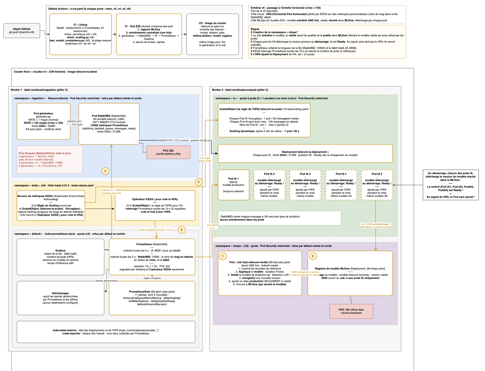

# 📈 CloudIA v6 : passage à l'échelle horizontal (autoscaling sur la file, modèle centralisé)

[](https://github.com/CedricKoukoui/CloudIA/actions/workflows/ci-cd.yaml)

> 📊 **Schéma d'architecture** : `schema-architecture-v5.png` (à la racine du dépôt) décrit la base de sécurité dont part la v6. Le schéma de la v6 reste à produire (section 16).
>
> 

Ce document ne décrit que la **version v6**. Elle part de la v5 (sécurité du cluster : RBAC, isolation réseau, TLS mutuel, secrets), elle-même construite sur la v4 (rétention des métriques) et la v3 (isolation des ressources). Pour les versions précédentes, voir les README des branches `v3`, `v4` et `v5`.

---

## 1. En bref

*   **Situation traitée :** le passage à l'échelle horizontal (*horizontal scaling*) quand le trafic des antennes est multiplié par 100, et la cohérence du modèle d'IA quand on duplique les pods.
*   **Côté Cloud :** un autoscaler **KEDA** pilote l'**HPA** de l'IA à partir de **deux métriques personnalisées** lues dans Prometheus : le nombre de messages en attente dans RabbitMQ et le débit traité. De 1 à 5 pods, plafonnés aussi par le quota du namespace.
*   **Côté IA / MLOps :** les pods ne s'entraînent plus. Un **Job** entraîne le modèle **une seule fois**, le valide (porte de qualité) et le publie dans un **registre MLflow**. Chaque pod télécharge la version promue (alias `production`), vérifie son empreinte SHA-256 et ne devient *Ready* qu'ensuite.
*   **Ce que la v6 vérifie :** le piège de la v5 est **mesuré** (`test_model_consistency.py`), les règles du passage à l'échelle sont contrôlées en CI (`check_scaling.py`), le cluster par `v6-checks.sh`, et la crise × 100 est rejouée par `v6-load-test.sh`.
*   **Sécurité conservée :** les nouveaux composants suivent les règles de la v5 (comptes sans jeton, non-root, Pod Security `restricted`, refus par défaut du réseau, aucun droit humain d'écriture).

---

## 2. La situation

> « Votre architecture utilise RabbitMQ et Kubernetes. Si le trafic d'antennes 5G multiplie par 100 en quelques secondes lors d'une crise, comment votre IA va-t-elle passer à l'échelle ? Que se passe-t-il au niveau de l'état de votre modèle d'IA si on duplique les conteneurs ? »

### 2.1 Le piège

*   **Dupliquer les pods de l'IA** (`replicas`) : ils lisent tous la même file RabbitMQ.
*   **L'état du modèle** : jusqu'à la v5, `app.py` tirait ses données d'entraînement au hasard (`np.random.normal` **sans graine**) puis entraînait son propre Isolation Forest au démarrage. Dix pods, c'est dix modèles différents.

### 2.2 Ce qui est vrai, et ce qui ne l'est pas, dans ce piège

**Plusieurs pods sur la même file : ce n'est PAS un problème.** C'est le modèle des **consommateurs concurrents** (*competing consumers*) : RabbitMQ remet chaque message à **un seul** consommateur. C'est justement ce qui permet le passage à l'échelle, sans doublon. Les vrais points d'attention sont le *prefetch* (section 8) et l'arrêt des pods en trop (acquittements).

**Un modèle par pod : c'est le vrai problème.** Il est mesuré par `test_model_consistency.py` (données de validation fixes, résultat reproductible) :

| Mesure sur 20 000 messages « limites » (proches de la frontière normal / anomalie) | Résultat |
|---|---|
| Deux pods entraînés comme en v5 rendent des verdicts différents | **6,5 %** des messages |
| Au moins deux des 10 pods se contredisent | **17,3 %** des messages |
| Deux modèles v6 (entraînement centralisé, graine fixée) | **0 %**, scores identiques au bit près |

Le même message peut donc être classé « anomalie » ou « normal » selon le pod qui le reçoit. Les anomalies franches du générateur (500 à 800 paquets) sont détectées par tous les pods ; ce sont les cas ambigus, ceux qui comptent en crise, qui divergent.

### 2.3 La réponse attendue

1.  **Côté Cloud :** un **HPA** basé sur des **métriques personnalisées**, comme le nombre de messages en attente dans RabbitMQ.
2.  **Côté IA / MLOps :** **découpler le modèle** des pods. Il est entraîné une fois de manière centralisée, stocké dans un **registre de modèles** (MLflow ou Triton), puis les pods téléchargent la version validée pour l'inférence.

---

## 3. Ce que la v5 couvre, et ce qui lui manque

| # | Manque constaté en v5 | Traité en v6 par |
|---|---|---|
| 1 | Nombre de pods de l'IA figé à 1 (`replicas: 1`). | `10-autoscaling.yaml` (KEDA + HPA), `deployment.yaml` sans `replicas` |
| 2 | Quota du namespace `ia` égal aux requests d'**un** pod : impossible d'en ajouter un deuxième. | `01-namespaces-quotas.yaml` (6 pods) |
| 3 | Stratégie `Recreate` : chaque mise à jour coupe l'IA. | `deployment.yaml` (RollingUpdate, `maxUnavailable: 0`) |
| 4 | Longueur de la file inconnue de Prometheus. | port 15692 de RabbitMQ, PodMonitor dans `10-autoscaling.yaml` |
| 5 | Modèle entraîné dans chaque pod, sur des données aléatoires sans graine. | `train.py`, `model_lib.py`, `09-train-job.yaml` |
| 6 | Aucun registre, aucune version, aucune validation du modèle. | `08-mlops.yaml` (MLflow), porte de qualité, alias `production` |
| 7 | Un pod est « prêt » dès son démarrage, avant d'avoir un modèle. | `readinessProbe` sur le chargement du modèle |
| 8 | Un pod arrêté par l'autoscaler coupe net (SIGTERM non géré). | `app.py` (arrêt propre) |
| 9 | Un journal par message : coûteux à 100 messages/s et 5 pods. | `app.py` (anomalies + résumé toutes les 10 s) |

---

## 4. Comment on le résout : les étapes

| Étape | Action | Effet |
|---|---|---|
| **1. Registre** | Serveur **MLflow** dans un namespace `mlops` (SQLite et fichiers sur un volume persistant). | Un endroit unique où le modèle est versionné. |
| **2. Entraînement centralisé** | Un **Job** lance `train.py` : données reproductibles (graine), entraînement, **porte de qualité**, enregistrement, alias `production` seulement si le modèle est valide. | Un seul modèle, validé, traçable (paramètres, métriques, empreinte). |
| **3. Inférence sans état** | `app.py` télécharge la version désignée par l'alias, vérifie l'empreinte, puis consomme. Plus aucun `fit()` dans le pod. | Tous les pods servent le même modèle ; dupliquer un pod ne crée plus de divergence. |
| **4. Métriques de la file** | RabbitMQ expose ses métriques (port 15692) ; un PodMonitor les fait collecter par Prometheus toutes les 5 s. | La longueur de la file devient une métrique Kubernetes exploitable. |
| **5. Autoscaling** | **KEDA** lit deux requêtes Prometheus et pilote l'**HPA** de l'IA (1 à 5 pods). | L'IA suit la crise, puis revient à 1 pod. |
| **6. Plafonds** | Quota `ia` à 6 pods ; quota `mlops` ; `nodeSelector` (KEDA sur `ingestion`, IA et MLflow sur `compute`). | Un autoscaler déréglé ne peut pas affamer le reste du cluster. |
| **7. Contrôles** | `test_model_consistency.py`, `check_scaling.py` et `check_security.py` en CI ; `v6-checks.sh` et `v6-load-test.sh` sur le cluster ; 5 règles d'alerte. | Chaque élément de la réponse est vérifié. |

**Décisions prises**

| Sujet | Décision | Pourquoi |
|---|---|---|
| Autoscaler | **KEDA** (déclencheur Prometheus), qui crée et pilote un HPA standard | Réutilise la pile Prometheus de la v4 ; gère le repli si Prometheus ne répond plus ; remet le minimum si l'IA est mise à 0. Alternative : `prometheus-adapter` + HPA écrit à la main (même résultat, plus de configuration). |
| Métrique | **Retard de la file ET débit traité** | Le retard seul fait osciller : file vidée, pods retirés, retard qui revient (section 6.2). |
| Registre | **MLflow 3.17.1** (serveur officiel, client `mlflow-skinny`) | Registre, versions, alias, métriques de validation. **Triton** est un serveur d'inférence (GPU, gRPC) : il remplacerait l'IA elle-même, trop lourd ici. |
| Distribution du modèle | Téléchargement au démarrage du pod | L'inférence reste locale (aucun appel réseau par message, ~2 ms par prédiction). Alternative : une API d'inférence centrale, au prix d'un appel réseau par message. |
| Nouvelle version | **Alias** `production` + redémarrage progressif | Les pods en service ne changent jamais de modèle en cours de route ; la bascule est contrôlée. |

---

## 5. Fichiers ajoutés ou modifiés

| Fichier | Statut | Rôle |
|---|---|---|
| `model_lib.py` | nouveau | Données reproductibles, entraînement, jeu de validation, **porte de qualité**. |
| `train.py` | nouveau | Entraînement centralisé : valide, enregistre dans MLflow, promeut (alias `production`) seulement si valide. |
| `model_registry.py` | nouveau | Téléchargement d'une version **précise**, contrôle de l'empreinte SHA-256, nouvel essai sans jamais s'entraîner. |
| `app.py` | modifié | Plus d'entraînement ; modèle du registre ; sonde *Ready* ; métriques `telecom_model_info` et `telecom_inference_seconds` ; arrêt propre ; journaux limités. |
| `08-mlops.yaml` | nouveau | Registre MLflow : volume, Deployment (non-root, `--allowed-hosts`, 1 processus), Service. |
| `09-train-job.yaml` | nouveau | Job d'entraînement (`kubectl create`, un nouveau Job à chaque lancement). |
| `10-autoscaling.yaml` | nouveau | PodMonitor des métriques de la file + `ScaledObject` KEDA (2 déclencheurs, repli, comportement de l'HPA). |
| `keda-values.yaml` | nouveau | Valeurs Helm de KEDA : ressources réduites, `nodeSelector`. |
| `01-namespaces-quotas.yaml` | modifié | Quota `ia` pour 6 pods ; namespace et quota `mlops` ; Pod Security `restricted` déclaré. |
| `02-network-policy.yaml` | modifié | Règles 9 à 14 : métriques de RabbitMQ, IA → registre, namespace `mlops` en refus par défaut. |
| `04-network-policy-observability.yaml` | modifié | Opérateur KEDA → Prometheus:9090. |
| `05-rbac.yaml` | modifié | Comptes `mlflow` et `model-trainer` sans jeton ; lecture de l'HPA et du ScaledObject ; `mlops` en lecture seule. |
| `06-alert-rules.yaml` | modifié | Groupe `cloudia.scaling` : 5 règles. |
| `deployment.yaml` | modifié | Sans `replicas`, RollingUpdate, sonde *Ready*, registre, pods plus petits (250m CPU). |
| `rabbitmq-v3-persistant.yaml` | modifié | Port 15692 nommé `prometheus`. |
| `generator-deployment.yaml` | modifié | `RATE` déclaré ; limite CPU 400m pour le débit de crise. |
| `requirements.txt`, `Dockerfile`, `.dockerignore` | modifiés / nouveau | Client MLflow et pandas ; `.dockerignore` exclut `.git`, `.venv`, clés et documentation de l'image. |
| `test_model_consistency.py`, `check_scaling.py` | nouveaux | CI : le piège mesuré, les règles du passage à l'échelle. |
| `check_security.py` | modifié | Couvre aussi MLflow, le Job, les nouvelles règles réseau et RBAC. |
| `v6-checks.sh`, `v6-load-test.sh` | nouveaux | Contrôles sur le cluster ; test de crise × 100. |
| `v5-checks.sh` | modifié | « au moins 1 réplique » au lieu de « exactement 1 » ; test `SCALE_TEST` remplacé par celui de la v6. |
| `docker-compose.test.yml`, `test_observability.py` | modifiés | Registre et entraînement dans la sonde Compose ; contrôle de `telecom_model_info`. |
| `.github/workflows/*.yaml` | modifiés | Branche `v6` ; nouvelles étapes de CI ; scénario « 3 pods, même modèle » dans le test Kind. |
| `.gitignore` | corrigé | Deux motifs étaient collés sur une ligne (`tls*/node_modules/`) : ni `tls*/` ni `node_modules/` n'étaient ignorés. |

---

## 6. Côté Cloud : l'autoscaling sur des métriques personnalisées

### 6.1 La chaîne de décision

```
RabbitMQ :15692 ──(5 s)──▶ Prometheus ◀──(10 s)── KEDA ──▶ HPA keda-hpa-telecom-ia-scaler ──▶ Deployment de l'IA (1 à 5 pods)
     longueur de la file        ▲                                                                   │
                                └──────────────── débit traité (telecom_processed_packets_total) ◀──┘
```

*   **Métriques de la file** : le plugin `rabbitmq_prometheus` (activé par défaut dans l'image officielle) expose `rabbitmq_detailed_queue_messages_ready{queue="telecom_traffic"}` sur `/metrics/detailed?family=queue_coarse_metrics`. Le PodMonitor `rabbitmq-queue-metrics` le fait collecter toutes les 5 s.
*   **KEDA** interroge Prometheus toutes les 10 s, calcule le nombre de pods voulu et met à jour l'HPA qu'il a créé (`keda-hpa-telecom-ia-scaler`). L'HPA modifie le Deployment.
*   **Le Deployment n'a plus de champ `replicas`** : sinon chaque `kubectl apply -f deployment.yaml` remettrait l'IA à 1 pod en pleine crise.

### 6.2 Deux métriques, pas une

| Déclencheur | Requête | Seuil par pod | Rôle |
|---|---|---|---|
| `backlog` | `sum(rabbitmq_detailed_queue_messages_ready{queue="telecom_traffic"})` | 100 messages | **Rattraper** le retard. |
| `throughput` | `sum(rate(telecom_processed_packets_total{namespace="ia"}[1m]))` | 50 messages/s | **Tenir** le débit. |

L'HPA retient la plus exigeante des deux. Avec le retard seul, la crise produirait une oscillation : les pods vident la file, le retard tombe à 0, l'HPA retire des pods alors que 100 messages/s arrivent toujours, le retard revient. Le débit traité garde le bon nombre de pods tant que la crise dure.

**Exemple attendu (à confirmer par `v6-load-test.sh`) :** à 100 messages/s, le déclencheur `throughput` demande 2 pods ; tant qu'un retard existe, `backlog` peut en demander davantage ; une fois rattrapé, l'IA se stabilise à 2 ; au retour à 1 message/s, elle redescend à 1.

Le seuil de 50 messages/s par pod est **un point de départ**. La capacité réelle d'un pod (limite de 250m CPU) se mesure avec `v6-load-test.sh` (ligne « Capacité d'un pod ») et se reporte dans le seuil, avec une marge.

### 6.3 Comportement de l'HPA

| Réglage | Valeur | Effet |
|---|---|---|
| `minReplicaCount` | 1 | Jamais 0 : la supervision tourne toujours. |
| `maxReplicaCount` | 5 | Plafond de l'autoscaler. |
| Montée | immédiate, jusqu'à +4 pods toutes les 15 s | De 1 à 5 pods en un pas : la crise arrive « en quelques secondes ». |
| Descente | 2 min de calme, puis −1 pod toutes les 30 s | Pas d'oscillation sur un creux passager. |
| Repli | 2 pods après 3 échecs de lecture | Si Prometheus ne répond plus, l'IA ne reste pas à 1 pod en aveugle. |

**Le délai réel de réaction** : collecte (5 s) + interrogation par KEDA (10 s) + boucle de l'HPA (15 s) + démarrage d'un pod (import de scikit-learn et MLflow, téléchargement du modèle, connexion TLS : quelques secondes). Comptez de l'ordre de 30 à 60 s avant qu'un nouveau pod consomme. Pendant ce temps, **la file absorbe le pic** : c'est le rôle du broker, et le retard est rattrapé ensuite. `v6-load-test.sh` mesure ce délai.

### 6.4 Les plafonds : quota et nœuds

*   **Quota `ia`** : 6 pods, `requests` 600m / 1536Mi, `limits` 1500m / 3Gi, soit 5 pods (maximum de l'autoscaler) + 1 pod de surplus pendant une mise à jour progressive. Le quota reste le **plafond dur** : un ScaledObject mal réglé ne peut pas consommer plus. `check_scaling.py` vérifie en CI que quota, `maxReplicaCount`, `maxSurge` et ressources du pod restent cohérents.
*   **Pods plus petits** : 250m CPU au lieu de 500m. Le passage à l'échelle horizontal préfère plusieurs petits pods à un gros (granularité, résistance à la perte d'un pod).
*   **Tous les pods de l'IA restent sur le worker `compute`** (pilier C). Au-delà, c'est la capacité du nœud qui limite : sur un vrai cluster, on ajouterait un *cluster autoscaler* (ajout de nœuds), hors de portée de Kind.

### 6.5 Mise à 0 réplique (rappel du scénario Q14)

Si quelqu'un met l'IA à 0 réplique, KEDA la remet au minimum au cycle suivant (environ 10 s) : c'est le comportement prévu par le code de KEDA 2.21, à confirmer sur le cluster avec `SELFHEAL_TEST=1 ./v6-checks.sh`. Conséquence : l'alerte `IaScaledToZero` de la v5 (`for: 30s`) ne se lève plus en pratique ; elle reste utile si l'autoscaler est supprimé.

---

## 7. Côté IA / MLOps : un modèle entraîné une fois, servi partout

### 7.1 Le cycle de vie du modèle

```
Job train-telecom-model-xxxxx (namespace mlops)
  1. données de référence, graine 42          (model_lib.make_training_data)
  2. Isolation Forest, random_state 42         (model_lib.train_model)
  3. validation sur un jeu indépendant         (2000 messages normaux + 500 anomalies du générateur)
  4. MLflow : run (paramètres, métriques), nouvelle version de « telecom-anomaly »,
     étiquettes quality_gate, model_sha256, detection_rate, false_positive_rate
  5. porte de qualité réussie ?  oui -> alias « production » sur cette version
                                 non -> version enregistrée mais pas promue, Job en échec
```

**Porte de qualité** : taux de détection ≥ 95 % et faux positifs ≤ 10 %. Résultats mesurés : modèle normal 100 % / 2,7 % (accepté) ; modèle volontairement trop sensible (`TRAINING_CONTAMINATION=0.3`) 100 % / 32,8 % (**refusé**, l'alias reste sur l'ancienne version).

### 7.2 Ce que fait chaque pod de l'IA au démarrage

1.  Demande au registre quelle version porte l'alias `production`.
2.  Télécharge **cette version précise** (`models:/telecom-anomaly/<n>`, pas l'alias) : si l'alias change entre les deux appels, le pod ne mélange pas deux versions.
3.  Calcule l'empreinte SHA-256 du fichier du modèle et la compare à celle notée par l'entraînement. Différente : le modèle est refusé.
4.  Expose `telecom_model_info{model_version, model_sha256}` et ouvre ses métriques.
5.  Se connecte à RabbitMQ, commence à consommer, **puis seulement** devient *Ready* (fichier `/tmp/model-ready`, lu par la sonde `exec`).

**Registre injoignable ou aucune version promue** : le pod attend et réessaie toutes les 5 s, sans jamais retomber sur un entraînement local. Il reste *non Ready* et ne consomme rien ; l'alerte `IaReplicasNotReady` le signale. Les pods déjà en service ne sont pas touchés : **le registre n'est nécessaire qu'au démarrage d'un pod**.

### 7.3 Promouvoir une nouvelle version

```bash
kubectl create -f 09-train-job.yaml                       # nouveau Job, nouvelle version
kubectl wait -n mlops --for=condition=complete job -l app=model-trainer --timeout=300s
kubectl rollout restart deployment/telecom-ia-deployment -n ia   # remplacement progressif, un pod à la fois
```

Pendant le remplacement, deux versions coexistent quelques secondes ; `IaModelVersionMismatch` ne se lève qu'au-delà de 10 minutes. Revenir en arrière : remettre l'alias sur l'ancienne version dans l'interface de MLflow (`kubectl port-forward -n mlops svc/mlflow 5000:5000`, puis http://localhost:5000), puis `rollout restart`.

### 7.4 Pourquoi pas une API d'inférence centrale ?

Une autre façon de découpler est d'interroger une **API d'inférence** (Triton, MLflow `models serve`) pour chaque message. Ici, l'inférence locale est préférée : environ 2 ms par prédiction, aucun appel réseau supplémentaire, et la montée en charge reste celle des consommateurs. L'API centrale se justifierait pour un gros modèle (GPU, plusieurs Go) qu'on ne veut pas charger dans chaque pod.

---

## 8. Plusieurs pods sur une même file

*   **Consommateurs concurrents** : chaque message va à un seul pod. Ajouter des pods augmente le débit total, sans doublon.
*   **`PREFETCH=50`** : chaque pod garde au plus 50 messages non acquittés. Quand un pod arrive en pleine crise, le reste de la file lui revient ; les messages déjà réservés par les autres restent chez eux. Un prefetch plus petit répartit plus finement, au prix de plus d'échanges avec le broker.
*   **Acquittement après traitement** : un message n'est retiré de la file qu'une fois classé.
*   **Arrêt propre** : quand l'HPA retire un pod, Kubernetes envoie SIGTERM. `app.py` ferme la connexion ; un message reçu mais pas encore acquitté retourne dans la file et un autre pod le traite. La garantie est **« au moins une fois »** : un message peut, rarement, être classé deux fois (jamais perdu).
*   **Journaux** : une ligne par anomalie, au plus une ligne « Normal » par seconde, et un résumé toutes les 10 s (`📈 523 messages en 10 s (52.3/s), 78 anomalie(s), modèle v3`).

---

## 9. Sécurité des nouveaux composants

Les règles de la v5 s'appliquent aux nouveaux composants, et `check_security.py` les vérifie.

| Composant | Règles appliquées |
|---|---|
| Registre MLflow | Compte `mlflow` sans jeton ; uid 10001 ; Pod Security `restricted` ; **aucune authentification**, donc le réseau est sa seule protection : seuls le Job d'entraînement et les pods de l'IA le joignent (port 5000). `--allowed-hosts` refuse tout en-tête Host inattendu (HTTP 403). |
| Job d'entraînement | Compte `model-trainer` sans jeton ; non-root ; seule sortie : MLflow:5000. |
| Générateur (pod exposé de Q3 / Q9) | Ne joint **ni** le registre (pas de faux modèle) **ni** les métriques de RabbitMQ. |
| Métriques de RabbitMQ (15692) | Ouvertes au seul pod Prometheus. |
| KEDA | Seul son opérateur joint Prometheus:9090. KEDA a besoin de droits à l'échelle du cluster (lire les métriques, modifier l'échelle des déploiements) : ce sont les `ClusterRole` installés par son chart, comme pour la pile Prometheus. |
| Humains | Lecture de l'HPA, du ScaledObject et de `mlops`. **Aucun** groupe ne lance d'entraînement, ne promeut un modèle ni ne modifie l'autoscaler. |

---

## 10. Alertes de la v6

| Alerte | Condition | Signification |
|---|---|---|
| `AutoscalingQueueMetricMissing` | longueur de la file absente de Prometheus pendant 5 min | L'autoscaler décide à l'aveugle (repli à 2 pods). |
| `IaBacklogHigh` | plus de 1000 messages en attente pendant 2 min | L'IA ne suit pas malgré l'autoscaler (quota, nœud, plafond). |
| `IaAtMaxReplicas` | HPA au maximum pendant 5 min | La prochaine hausse ne pourra pas être absorbée. |
| `IaReplicasNotReady` | des pods de l'IA pas prêts pendant 5 min | Registre injoignable, aucune version promue, quota. |
| `IaModelVersionMismatch` | plus d'une version du modèle en service pendant 10 min | Remplacement incomplet après une promotion. |

**Requêtes utiles dans Grafana** (Explore, source Prometheus) :

*   retard de la file : `sum(rabbitmq_detailed_queue_messages_ready{queue="telecom_traffic"})`
*   débit traité : `sum(rate(telecom_processed_packets_total{namespace="ia"}[1m]))`
*   nombre de pods : `kube_horizontalpodautoscaler_status_current_replicas{namespace="ia"}`
*   versions du modèle : `count by (model_version) (telecom_model_info{namespace="ia"})`
*   temps d'inférence (p95) : `histogram_quantile(0.95, sum by (le) (rate(telecom_inference_seconds_bucket{namespace="ia"}[1m])))`

---

## 11. Mise en œuvre

**Prérequis** : le cluster de la v5 (`cloudia-v3`, CNI `kindnet`), la release Helm `telecom-monitor`, les Secrets de `v5-secrets.sh`. **Mémoire** : la v6 ajoute environ 1,7 Go de requests au maximum (MLflow 512 Mi, KEDA 160 Mi, jusqu'à 4 pods d'IA de plus à 256 Mi). Prévoir au moins 8 Go pour Docker Desktop.

```bash
git checkout v5 && git pull origin v5 && git checkout -b v6   # puis copier les fichiers de la v6

# 1. Image (code v6 : client MLflow, plus d'entraînement local)
docker build -t telecom-ia:latest .
kind load docker-image telecom-ia:latest --name cloudia-v3

# 2. Namespaces (mlops), quotas, comptes de service et rôles
kubectl apply -f 01-namespaces-quotas.yaml -f 05-rbac.yaml

# 3. Registre de modèles, règles réseau (dont mlops), entraînement centralisé
kubectl apply -f 08-mlops.yaml
kubectl rollout status deploy/mlflow -n mlops --timeout=300s
kubectl apply -f 02-network-policy.yaml
kubectl create -f 09-train-job.yaml
kubectl wait -n mlops --for=condition=complete job -l app=model-trainer --timeout=300s
kubectl logs -n mlops -l app=model-trainer --tail=20          # « ✅ Modèle telecom-anomaly version 1 promu »

# 4. Broker (port des métriques), IA et générateur
kubectl apply -f rabbitmq-v3-persistant.yaml
kubectl rollout status statefulset/telecom-broker-rabbitmq -n ingestion --timeout=240s
kubectl apply -f deployment.yaml -f generator-deployment.yaml
kubectl rollout status deploy/telecom-ia-deployment -n ia --timeout=300s
kubectl rollout status deploy/telecom-generator-deployment -n ingestion --timeout=240s

# 5. KEDA, puis l'autoscaler et les règles qui l'accompagnent
helm repo add kedacore https://kedacore.github.io/charts && helm repo update
helm upgrade --install keda kedacore/keda --version 2.21.0 -n keda --create-namespace -f keda-values.yaml
kubectl rollout status deploy/keda-operator -n keda --timeout=300s
./v6-checks.sh preflight
kubectl apply -f 04-network-policy-observability.yaml -f 06-alert-rules.yaml -f 10-autoscaling.yaml

# 6. Contrôles
kubectl apply -f 07-tenant-simulation.yaml
./v5-checks.sh                      # la sécurité de la v5 tient toujours
./v6-checks.sh                      # registre, modèle unique, réseau, autoscaler, RBAC, alertes
SELFHEAL_TEST=1 ./v6-checks.sh      # l'IA mise à 0 est remise à 1 par KEDA
kubectl delete -f 07-tenant-simulation.yaml

# 7. Crise × 100 (≈ 10 min), relevés dans un fichier CSV
./v6-load-test.sh
```

*   **Premier `apply` de `deployment.yaml` depuis la v5** : le champ `replicas` disparaît, l'IA revient à 1 pod ; ensuite, l'autoscaler décide seul.
*   **Le pod v5 continue de tourner** pendant que le pod v6 démarre (RollingUpdate) : l'IA n'est jamais coupée.
*   **Un pod v6 reste « 0/1 »** : `kubectl logs -n ia <pod>`. « Modèle … indisponible » : le Job n'a pas tourné ou a échoué, ou la règle réseau 10 manque.
*   **Interface MLflow** : `kubectl port-forward -n mlops svc/mlflow 5000:5000`, puis http://localhost:5000.
*   **Démonstration de la porte de qualité** : `sed 's/"0.05"/"0.3"/' 09-train-job.yaml | kubectl create -f -` ; le Job échoue, l'alias reste sur la version précédente.

---

## 12. CI/CD (`.github/workflows/`)

**`ci-cd.yaml`** : déclenché à chaque push et pull request sur `main`, `v3`, `v4`, `v5` et `v6`.

| Étape | Ce qu'elle contrôle |
|---|---|
| **`test_model_consistency.py`** (v6) | Le piège mesuré (verdicts divergents entre pods v5), la reproductibilité de l'entraînement v6, la porte de qualité (acceptation et refus). |
| **`check_scaling.py`** (v6) | `app.py` n'appelle jamais `fit()` ; pas de `replicas` dans le Deployment ; quota ≥ (max + surplus) × ressources d'un pod ; deux déclencheurs ; repli ; PodMonitor par file ; `--allowed-hosts` ; même version de MLflow côté client et serveur. |
| `check_security.py` (v5, étendu) | Les règles de la v5, appliquées aussi à MLflow, au Job, aux règles réseau et aux rôles de la v6. |
| kubeconform (mode strict) | 14 manifestes, 61 ressources, schémas des CRD inclus (PodMonitor, PrometheusRule, **ScaledObject**). |
| shellcheck | `v5-*.sh` et `v6-*.sh`. |
| **Test E2E** (Compose) | Registre MLflow démarré, **entraînement centralisé lancé une fois**, puis la chaîne jusqu'à Grafana ; l'IA doit exposer `telecom_model_info` ; panne du broker et reprise. |

**`kind-e2e.yaml`** (à la demande) : en plus des contrôles de la v5, déploie le registre, lance le Job d'entraînement, **passe l'IA à 3 pods** et vérifie qu'ils servent la même version du modèle et que chacun reçoit des messages (consommateurs concurrents), puis `v6-checks.sh` en `CI_MODE`. KEDA et Prometheus ne sont pas installés dans ce job (trop lourds) : l'autoscaling lui-même est vérifié sur le cluster local.

---

## 13. Contrôles et statut de vérification

### 13.1 Ce que font les scripts

| Script | Contrôles |
|---|---|
| `v6-checks.sh preflight` | CRD et opérateur KEDA, label `app.kubernetes.io/name=keda-operator`, Service `prometheus-operated`, API `external.metrics.k8s.io`, CRD PodMonitor. |
| `v6-checks.sh` | Registre : pod prêt, volume, dernier Job, alias `production` et porte de qualité. Cohérence : une seule version:empreinte dans tous les pods (journaux et Prometheus), égale à la production, aucun entraînement local, pods *Ready*. Réseau : IA → MLflow autorisé ; générateur → MLflow, générateur et IA → 15692 bloqués ; file collectée par Prometheus. Autoscaler : ScaledObject prêt, pas de repli, HPA 1-5, valeurs lues. Quota. RBAC (7 cas). Alertes (5 règles). Option `SELFHEAL_TEST=1`. |
| `v6-load-test.sh` | Crise à `CRISIS_RATE` messages/s (100 par défaut), retour au calme ; toutes les 10 s : retard, débit, pods demandés/prêts, versions du modèle ; bilan et fichier CSV. |

### 13.2 Ce qui a été vérifié, et ce qui ne l'est pas

**Vérifié hors cluster** (Python 3.10, mêmes versions que l'image : numpy 1.26.4, scikit-learn 1.4.2, mlflow-skinny 3.17.1, pandas 2.2.3 ; serveur MLflow 3.17.1) :

*   le cycle complet du registre contre un vrai serveur MLflow : entraînement, porte de qualité, enregistrement, alias, téléchargement par l'IA, contrôle d'empreinte, modèle chargé identique au modèle de référence ;
*   le refus d'un modèle trop sensible : version 4 enregistrée, Job en échec, alias resté sur la version 3 ;
*   `--allowed-hosts` : sans le nom DNS du Service, MLflow répond **403** au client ; avec la liste de `08-mlops.yaml`, 200 pour `mlflow.mlops.svc.cluster.local:5000`, 403 pour un Host inconnu ;
*   la mémoire du serveur MLflow : environ 2 Go avec les tâches de fond (dix processus), environ 470 Mo sans (`MLFLOW_SERVER_ENABLE_JOB_EXECUTION=false`, `--workers=1`) ;
*   `app.py` avec un broker simulé : modèle chargé, sonde *Ready* écrite, messages classés et acquittés (message illisible compris), métriques exposées, arrêt propre sur SIGTERM ;
*   mémoire d'un pod d'IA ≈ 200 Mo (limite 512 Mi) ; prédiction unitaire ≈ 1,7 ms sur le processeur de test ;
*   `test_model_consistency.py`, `check_scaling.py`, `check_security.py` passent ;
*   kubeconform strict : 61 ressources valides ; `promtool` : les 11 règles et les requêtes de KEDA sont du PromQL valide ; `shellcheck` et `actionlint` sans erreur ;
*   les noms de métriques de RabbitMQ (`rabbitmq_detailed_queue_messages_ready`, famille `queue_coarse_metrics`) et l'activation du plugin dans l'image officielle, lus dans les sources de RabbitMQ et de l'image Docker ;
*   les champs du `ScaledObject` (repli, comportement de l'HPA, noms des déclencheurs) et la remise au minimum d'une IA mise à 0, lus dans les sources de KEDA 2.21.0.

**Non vérifié (à faire sur le cluster et en CI) :**

*   la construction de l'image (`docker build`) et la sonde Compose complète ;
*   le déploiement sur Kind : MLflow non-root sur le volume `local-path`, Job, règles réseau 9 à 14 et KEDA → Prometheus avec `kindnet` ;
*   l'autoscaling réel : délai de réaction, pic de pods, capacité d'un pod à 250m CPU, retour à 1 pod (`v6-load-test.sh`) ;
*   l'auto-réparation après une mise à 0 (`SELFHEAL_TEST=1`) ;
*   les workflows `ci-cd.yaml` et `kind-e2e.yaml` sur GitHub.

---

## 14. Limites de la v6

*   **Un seul nœud de calcul.** Les pods de l'IA sont tous sur le worker `compute` : au-delà de sa capacité, ajouter des pods ne sert plus. Sur un vrai cluster : *cluster autoscaler* (ajout de nœuds).
*   **Registre MLflow sans haute disponibilité** : une réplique, SQLite, volume local. Indisponible, il empêche seulement de **démarrer** de nouveaux pods (ceux en service continuent). En production : base PostgreSQL, stockage objet (S3, MinIO), plusieurs répliques.
*   **Registre sans authentification.** Seul le réseau le protège. Un pod d'IA compromis pourrait y enregistrer une version et déplacer l'alias. Piste : `mlflow server --app-name basic-auth` avec un compte en lecture seule pour l'IA.
*   **Format pickle.** Charger un modèle pickle exécute du code : un modèle piégé déposé dans le registre s'exécuterait dans les pods. L'empreinte SHA-256 détecte un fichier altéré dans le stockage, pas une version malveillante enregistrée avec sa propre empreinte. Piste : format `skops`, signature des modèles.
*   **Données d'entraînement synthétiques.** Le modèle est entraîné sur la même référence que la v5 (rendue reproductible). Un vrai entraînement utiliserait des données historiques versionnées (et la détection de dérive pour décider d'un réentraînement).
*   **Autoscaling dépendant de Prometheus.** Si Prometheus tombe, KEDA passe en repli (2 pods). Alternative : le déclencheur RabbitMQ natif de KEDA (lecture directe du broker), au prix d'identifiants et de certificats de plus.
*   **Garantie « au moins une fois ».** Un message peut, rarement, être classé deux fois lors d'un arrêt de pod.
*   **Seuils à calibrer.** 100 messages en attente et 50 messages/s par pod sont des valeurs de départ, à ajuster avec `v6-load-test.sh`.
*   **Hérité de la v5 :** certificats auto-signés à rotation manuelle, Secrets non chiffrés dans etcd, alertes sans destinataire, pas de maillage de services.

---

## 15. Registre des paramètres de la v6

| Paramètre | Valeur | Défini dans | Justification |
|---|---|---|---|
| Pods de l'IA | 1 à 5 | `10-autoscaling.yaml` | Jamais 0 ; plafond compatible avec le quota. |
| Seuil `backlog` | 100 messages en attente par pod | `10-autoscaling.yaml` | Rattraper un retard d'environ 1 à 2 s de travail par pod. |
| Seuil `throughput` | 50 messages/s par pod | `10-autoscaling.yaml` | Tenir le débit avec une marge ; à calibrer. |
| Montée / descente | +4 pods / 15 s ; −1 pod / 30 s après 2 min | `10-autoscaling.yaml` | Réaction rapide, pas d'oscillation. |
| Repli | 2 pods après 3 échecs | `10-autoscaling.yaml` | Prudence si Prometheus ne répond plus. |
| Interrogation / collecte | 10 s (KEDA) / 5 s (RabbitMQ) | `10-autoscaling.yaml` | Délai de réaction de l'ordre de 30 à 60 s. |
| Ressources d'un pod d'IA | requests 100m / 256Mi, limits 250m / 512Mi | `deployment.yaml` | Petits pods, plus nombreux ; mémoire mesurée ≈ 200 Mo. |
| Quota `ia` | 6 pods ; 600m / 1536Mi ; 1500m / 3Gi | `01-namespaces-quotas.yaml` | 5 pods + 1 de surplus (RollingUpdate). |
| Mise à jour | RollingUpdate, `maxSurge: 1`, `maxUnavailable: 0` | `deployment.yaml` | L'IA n'est jamais coupée. |
| Prefetch | 50 messages par pod | `deployment.yaml` | Répartition entre consommateurs concurrents. |
| Modèle | `telecom-anomaly@production` | `deployment.yaml`, `09-train-job.yaml` | Une version validée, la même pour tous les pods. |
| Porte de qualité | détection ≥ 95 %, faux positifs ≤ 10 % | `model_lib.py` | Un modèle douteux n'est jamais promu. |
| Données d'entraînement | 500 échantillons, graine 42 | `09-train-job.yaml` | Reproductibles. |
| Registre | MLflow 3.17.1, 1 processus, SQLite, volume 1 Gi | `08-mlops.yaml` | Suffisant pour la démonstration ; mémoire ≈ 470 Mo mesurée. |
| Quota `mlops` | 400m / 1Gi ; 1500m / 1536Mi | `01-namespaces-quotas.yaml` | MLflow + un Job d'entraînement. |
| KEDA | 2.21.0, ressources réduites, worker `ingestion` | `keda-values.yaml` | Piliers A et C. |
| Débit de crise | 100 messages/s (× 100) | `v6-load-test.sh` | Scénario de la question. |
| Générateur | limite 400m CPU | `generator-deployment.yaml` | Publier 100 messages/s en TLS avec confirmation. |

---

## 16. Suite possible

*   **Schéma de la v6** (`schema-architecture-v6.png`) : namespace `mlops` (MLflow, Job), KEDA et la boucle RabbitMQ → Prometheus → KEDA → HPA → IA, sur la base du schéma de la v5.
*   **Section 13.2** : y reporter les résultats de `v6-checks.sh`, de `SELFHEAL_TEST=1` et le bilan de `v6-load-test.sh` (fichier CSV), puis ajuster le seuil `throughput`.
